# NetOps with Kong AI Gateway and Cisco MCP servers

[](https://konghq.com/products/kong-ai-gateway)
[](https://cloud.konghq.com)
[](https://www.keycloak.org)
[](https://www.postgresql.org)
[](https://docs.docker.com/compose/)
[](https://modelcontextprotocol.io)
[](https://github.com/ponchotitlan/pyATS_MCP)
[](https://claude.com/claude-code)
[](https://openid.net/connect/)
[](https://www.gnu.org/software/bash/)

A proof of concept for running AI-driven network operations safely: Kong AI
Gateway sits between AI assistants and Cisco MCP servers and decides **who**
may use **which tools**, and records **what they did**. The first use case
is the [pyATS MCP server](https://github.com/ponchotitlan/pyATS_MCP).

- [Why this PoC](#why-this-poc)
- [General architecture](#general-architecture)
- [Use case: the pyATS MCP server](#use-case-the-pyats-mcp-server)
- [Run it yourself](#run-it-yourself)
- [How the observability stack works](#how-the-observability-stack-works)
- [Reference](#reference)

## Why this PoC

AI assistants such as Claude Code can now operate a network through **MCP
servers**. An MCP server exposes tools like "run a show command" or
"configure a device", and the model decides when to call them. That's
powerful, and it raises the questions every NetOps team asks about any
access to its devices:

| Question | Without a gateway | With Kong AI Gateway |
|---|---|---|
| **Who is calling?** | The MCP server usually doesn't know | Every request carries a token from the corporate identity provider |
| **What may they do?** | Every client sees every tool, including config changes | Each role sees and can call only its tools; the rest are blocked before they reach the server |
| **What happened?** | Scattered, per-server logs, if any | One record per tool call: when, who, which tool, arguments, reply, allowed or denied |

The goal of this PoC is to show that these controls can live **in the
gateway, not in each MCP server**. The MCP servers stay unchanged, users and
roles stay in the identity provider, and adding another MCP server means
reusing the same login, the same kind of rules and the same dashboards.

## General architecture

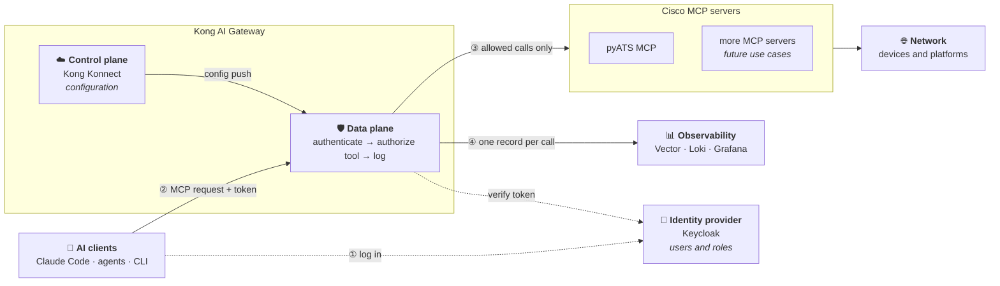

Every MCP request goes through the same four steps:

1. **Log in.** The user signs in to the identity provider and gets a token
   that names them and carries their role.
2. **Authenticate.** The gateway's data plane checks the token on every
   request. No valid token, no access.
3. **Authorize per tool.** The gateway maps the role to a set of allowed
   tools. It hides the other tools from the tool list and blocks calls to
   them, so they never reach the MCP server.
4. **Observe.** The gateway logs every call (who, tool, decision, request
   and reply) to the observability stack.

| Building block | Role | In this PoC |
|---|---|---|
| Identity provider | Owns users and roles, issues tokens | Keycloak (OpenID Connect) |
| Gateway control plane | Holds the configuration: MCP servers, login settings, roles, tool rules, log policies | Kong Konnect (cloud) |
| Gateway data plane | The only way in: enforces that configuration on every request | Kong AI Gateway container |
| MCP servers | Expose the actual tools; unchanged | pyATS MCP server |
| Observability | Collects, stores and shows the gateway's logs | Vector → Loki → Grafana |

The control plane and data plane are split: you configure in Konnect (UI or
API), and the data plane runs next to the MCP servers and receives that
configuration over mTLS. MCP traffic and its logs never pass through
Konnect.

## Use case: the pyATS MCP server

### The scenario

[Cisco pyATS](https://developer.cisco.com/pyats/) is Cisco's network test
and automation framework. The
[pyATS MCP server](https://github.com/ponchotitlan/pyATS_MCP) turns it into
nine MCP tools, from read-only ones like `show` commands to ones that change
the network, like pushing configuration.

A NetOps team has two kinds of people: **viewers**, who troubleshoot, and
**admins**, who may also change things. The gateway gives each role only
its tools:

| Role (`mcp_role` claim) | Keycloak user        | Tools                                                                                                                              |
|-------------------------|----------------------|------------------------------------------------------------------------------------------------------------------------------------|
| `netops-viewer`         | `netops-viewer-user` | `pyats_list_devices`, `pyats_run_show_command`, `pyats_show_running_config`, `pyats_show_logging`, `pyats_ping_from_network_device` |
| `netops-admin`          | `netops-admin-user`  | all of the above, plus `pyats_configure_device`, `pyats_run_linux_command`, `pyats_run_dynamic_test`, `pyats_load_external_inventory` |

Both users' password is `kong`. No token gets a 401; a valid token without a
known `mcp_role` gets a 403. As a viewer, Claude Code doesn't even see the
config tools, so asking it to change the network simply isn't possible.

### Deployment

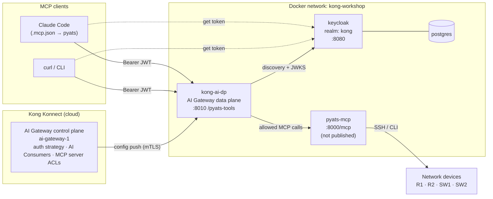

- **Konnect** holds the configuration: the `pyats-tools` MCP server, the
  `keycloak-kong` auth strategy, the AI Consumers and the access rules. It
  pushes them to the data plane.
- **`kong-ai-dp`** is the only way in. It validates every request's token,
  works out the caller's role and enforces the tool rules before anything
  reaches pyATS.
- **Keycloak** issues tokens with an `mcp_role` claim. Users and their roles
  live only here.
- **`pyats-mcp`** isn't published on the host, so it can't be called
  without going through Kong.

### How it's implemented

#### 1. Identity: Keycloak

[keycloak/setup.sh](keycloak/setup.sh) creates:

- the **`kong` realm**, which holds the users;
- the public **`mcp-client`** client, which MCP clients use to log in;
- a mapper that copies each user's `mcp_role` attribute into an **`mcp_role`
  claim** in their access token;
- the two users, `netops-viewer-user` and `netops-admin-user`.

Roles live only in Keycloak. To give someone access, create them in the
`kong` realm with an `mcp_role` attribute of `netops-admin` or
`netops-viewer`. Nothing changes in Kong.

#### 2. Authentication and tool rules: Kong AI Gateway

[konnect/create-mcp-acl.sh](konnect/create-mcp-acl.sh) configures the AI
Gateway in Konnect. It's safe to re-run, and resets the access rules to the
ones below.

1. **MCP server `pyats-tools`**, created if missing: a passthrough listener
   on `/pyats-tools` forwarding to `http://pyats-mcp:8000/mcp`.
2. **Auth strategy `keycloak-kong`** (`openid-connect`): validates the bearer
   token against `http://keycloak:8080/realms/kong` and maps its `mcp_role`
   claim to the AI Consumer with that name (`consumer_claims: [["mcp_role"]]`,
   `consumer_by: username`, `consumer_optional: false`). It also copies the
   token's `preferred_username` into an `X-Authenticated-User` header on every
   request it forwards to pyATS (`upstream_headers_claims` /
   `upstream_headers_names`), so the MCP server knows which user made each
   tool call, not just their role. Kong replaces any `X-Authenticated-User`
   header the client sends with the value from the token, so it can't be
   faked.
3. **AI Consumers `netops-admin` and `netops-viewer`**: one per role.
4. **Access rules on `pyats-tools`**:
   ```yaml
   access:
     auth_strategies: [keycloak-kong]
     acl_attribute_type: consumer
     acls:              { allow: [netops-admin, netops-viewer] }   # who may connect
     default_tool_acls: { allow: [netops-admin, netops-viewer] }   # tools without their own rule
   tools:                                                           # replace the default per tool
     - { name: pyats_configure_device,        access: { acls: { allow: [netops-admin] } } }
     - { name: pyats_run_linux_command,       access: { acls: { allow: [netops-admin] } } }
     - { name: pyats_run_dynamic_test,        access: { acls: { allow: [netops-admin] } } }
     - { name: pyats_load_external_inventory, access: { acls: { allow: [netops-admin] } } }
   ```

To see it in the Konnect UI, go to **AI Gateway → ai_gateway_1**:

| Object | Where |
|---|---|
| Auth strategy | **Auth Strategies → Keycloak (kong realm)** |
| Consumers | **Consumers** → `netops-admin`, `netops-viewer` |
| Access rules | **MCP servers → pyATS Tools** → **ACLs** (attribute type, **Default tool ACL**) and **Tools** |

`pyats-tools` is a passthrough listener, so Konnect never stores the pyATS
tool list: **Tools** shows only the four tools with their own rule, and every
other tool falls under the default tool ACL. Tool names aren't checked
against the server, so a typo silently leaves that tool open to viewers.

#### 3. Connecting Claude Code

Users log in once with [keycloak/mcp-auth.sh](keycloak/mcp-auth.sh), and
Claude Code fetches a fresh token from it whenever it connects.

`./keycloak/mcp-auth.sh login` exchanges your password for an offline refresh
token and stores only that token in `~/.config/pyats-mcp/session` (mode
600), never the password. The `pyats` entry in [.mcp.json](.mcp.json) runs
`./keycloak/mcp-auth.sh headers` as its `headersHelper` on every connect,
trading the stored token for a fresh access token. If a call gets a 401 or
403, Claude Code runs the helper again and retries once. Claude Code runs
the helper without a terminal, so it can't prompt you; that's why `login` is
a separate step.

#### 4. Observability

[konnect/create-mcp-observability.sh](konnect/create-mcp-observability.sh)
attaches an `http-log` policy to `pyats-tools`, so the data plane sends a log
record for every MCP request to Vector. Vector turns each record into one
event per MCP call (who, role, tool, decision, request, reply) and stores it
in Loki, and a Grafana dashboard shows it. See
[How the observability stack works](#how-the-observability-stack-works).

### Request flow

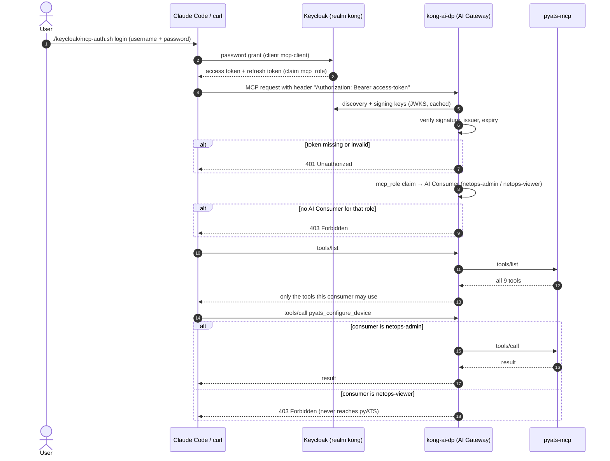

Every allow/deny decision is written to the AI Gateway's audit log.

### Design notes

#### Why consumers instead of matching the claim directly

The MCP server can match rules against a token claim directly
(`acl_attribute_type: oauth_access_token`). With this setup the gateway
rejected that with "access token claims not available"; it seems to need
the `access.metadata` OAuth setup. Mapping `mcp_role` to one AI Consumer per
role keeps Keycloak as the only place that assigns roles, with just two
objects in Kong. The trade-off: Konnect's analytics and logs show the role,
not the individual user. The user still reaches pyATS in the
`X-Authenticated-User` header (see [Authentication and tool rules](#2-authentication-and-tool-rules-kong-ai-gateway)).

#### Keycloak issuer

`KC_HOSTNAME=http://localhost:8080` pins the token issuer to the host-facing
URL, so a token fetched from the laptop validates in Kong, which reaches
Keycloak as `keycloak:8080`. `KC_HOSTNAME_BACKCHANNEL_DYNAMIC=true` keeps
`jwks_uri` / `token_endpoint` on whatever host was used:

```bash
docker run --rm --network kong-workshop curlimages/curl -s \
  http://keycloak:8080/realms/kong/.well-known/openid-configuration | jq '{issuer, jwks_uri}'
# issuer   => http://localhost:8080/realms/kong
# jwks_uri => http://keycloak:8080/realms/kong/protocol/openid-connect/certs
```

## Run it yourself

### Prerequisites

- Docker, `jq` and `curl`
- A Konnect account and a [Personal Access Token](https://cloud.konghq.com/global/account/tokens)
- The `pyats-mcp:latest` image, built from `../pyATS_MCP` with
  `docker compose build` there. It mounts `../pyATS_MCP/testbed.yaml`; set
  `PYATS_TESTBED_FILE` to use a different testbed.
- `cisco-ca.pem` in this directory: the corporate root CA that `kong-ai-dp`
  trusts for outbound HTTPS. It's git-ignored, so copy it in yourself. Off
  the corporate network, any valid PEM certificate will do.

### Step 1: Create the AI Gateway

1. Put your token in `.env` (see [.env.example](.env.example)):
   ```bash
   cp .env.example .env
   # edit .env: PAT=kpat_...
   ```
2. Create the AI Gateway and the data plane certificate:
   ```bash
   ./konnect/create-ai-gateway.sh
   ```
   `KONNECT_REGION` defaults to `eu`; set `us`, `au`, `in` or `me` to match
   the subdomain of your Konnect UI (`KONNECT_REGION=us ./konnect/create-ai-gateway.sh`).
   The script creates `ai-gateway-1` (or reuses it), generates
   `certs/kong-ai/tls.crt` / `tls.key`, registers the certificate, and writes
   `AI_GATEWAY_ID` and the `AI_KONNECT_*` endpoints into `.env`.
3. Start the containers:
   ```bash
   docker compose up -d
   ```
   If you previously `source`d `.env` in the same shell, `unset` the
   `AI_KONNECT_*` variables first: exported values win over `.env`, and the
   data plane would connect to the old cluster.
4. Check that the data plane registered:
   ```bash
   set -a; . ./.env; set +a
   curl -s https://eu.api.konghq.com/v1/ai-gateways/$AI_GATEWAY_ID/nodes \
     -H "Authorization: Bearer $PAT" | jq '.data[] | {hostname, version}'
   ```

### Step 2: Set up the Keycloak users

1. Wait for Keycloak to answer on `http://localhost:8080`, then:
   ```bash
   ./keycloak/setup.sh
   ```
   This creates the `kong` realm, the public `mcp-client` client (whose
   access tokens carry the `mcp_role` claim), and the two users. It's safe to
   re-run.
2. Check the users:
   - **Admin console:** open http://localhost:8080, log in as `admin` /
     `admin`, switch the realm dropdown from **master** to **kong**, then
     **Users**. A user's role is on its **Attributes** tab (`mcp_role`).
   - **CLI:**
     ```bash
     ADMIN=$(curl -s http://localhost:8080/realms/master/protocol/openid-connect/token \
       -d client_id=admin-cli -d username=admin -d password=admin -d grant_type=password | jq -r .access_token)
     curl -s "http://localhost:8080/admin/realms/kong/users?briefRepresentation=false" \
       -H "Authorization: Bearer $ADMIN" \
       | jq -r '.[] | [.username, (.attributes.mcp_role // ["-"])[0]] | @tsv'
     ```

To add a user, create them in the **kong** realm with an `mcp_role`
attribute of `netops-admin` or `netops-viewer`. Nothing changes in Kong.

### Step 3: Protect the MCP server

```bash
./konnect/create-mcp-acl.sh
```

This creates the MCP server, the Keycloak auth strategy, the two AI
Consumers and the tool rules described in
[Authentication and tool rules](#2-authentication-and-tool-rules-kong-ai-gateway).
Then check all the cases at once:

```bash
./keycloak/test-mcp-acl.sh
```

Expected: no token → 401; the viewer sees 5 tools and gets 403 on
`pyats_configure_device`; the admin sees all 9.

### Step 4a: Use it from the CLI

Every request needs `Authorization: Bearer <access token>`. MCP over HTTP is
a session: `initialize`, then `notifications/initialized`, then any number of
requests carrying the `Mcp-Session-Id` header the server returned.

1. Get a token for a user:
   ```bash
   TOKEN=$(curl -s http://localhost:8080/realms/kong/protocol/openid-connect/token \
     -d client_id=mcp-client -d grant_type=password \
     -d username=netops-viewer-user -d password=kong | jq -r .access_token)
   ```
   Or reuse your `mcp-auth.sh` login (see 4b):
   `TOKEN=$(./keycloak/mcp-auth.sh headers | jq -r .Authorization | cut -d' ' -f2)`
2. Open an MCP session through Kong:
   ```bash
   MCP=http://localhost:8010/pyats-tools
   H=(-H "Authorization: Bearer $TOKEN" -H 'Content-Type: application/json' -H 'Accept: application/json, text/event-stream')

   SESSION=$(curl -s -D - -o /dev/null "${H[@]}" $MCP \
     -d '{"jsonrpc":"2.0","id":1,"method":"initialize","params":{"protocolVersion":"2025-06-18","capabilities":{},"clientInfo":{"name":"curl","version":"0"}}}' \
     | awk 'tolower($1)=="mcp-session-id:" {print $2}' | tr -d '\r')
   curl -s "${H[@]}" -H "Mcp-Session-Id: $SESSION" $MCP -d '{"jsonrpc":"2.0","method":"notifications/initialized"}'
   ```
3. List the tools this user may see:
   ```bash
   curl -s "${H[@]}" -H "Mcp-Session-Id: $SESSION" $MCP \
     -d '{"jsonrpc":"2.0","id":2,"method":"tools/list"}' \
     | sed -n 's/^data: //p' | jq -r '.result.tools[].name'
   ```
4. Call an allowed tool:
   ```bash
   curl -s "${H[@]}" -H "Mcp-Session-Id: $SESSION" $MCP \
     -d '{"jsonrpc":"2.0","id":3,"method":"tools/call","params":{"name":"pyats_run_show_command","arguments":{"device_name":"R1","command":"show version"}}}' \
     | sed -n 's/^data: //p' | jq -r '.result.content[0].text | fromjson | .raw_output' | head -3
   ```
5. Try a config tool. As the viewer this prints `403` and the call never
   reaches pyATS. **As the admin it really applies the config**, creating
   `Loopback99` on R1:
   ```bash
   curl -s -o /dev/null -w '%{http_code}\n' "${H[@]}" -H "Mcp-Session-Id: $SESSION" $MCP \
     -d '{"jsonrpc":"2.0","id":4,"method":"tools/call","params":{"name":"pyats_configure_device","arguments":{"device_name":"R1","config_commands":"interface Loopback99"}}}'
   ```

The same commands work in bash and zsh. Repeat with
`username=netops-admin-user` to see all 9 tools.

### Step 4b: Use it from Claude Code

1. Log in once in a terminal, with any user from the **kong** realm:
   ```bash
   ./keycloak/mcp-auth.sh login     # prompts for username / password
   ./keycloak/mcp-auth.sh status    # Logged in as netops-viewer-user (mcp_role: netops-viewer)
   ```
2. Start `claude` in this directory (CLI or VS Code extension) and run
   `/mcp`. The `pyats` server shows as connected, with 5 tools for the viewer
   or 9 for the admin. [.claude/settings.json](.claude/settings.json)
   pre-approves it, so there's no approval prompt.
3. Ask something like *"List all interfaces of R1"*. As the viewer, a request
   to change config fails, because Claude Code never sees the config tools.
4. To switch user, run `login` again with the other user, then reconnect
   `pyats` from `/mcp`.
5. When you're done:
   ```bash
   ./keycloak/mcp-auth.sh logout    # revokes the session in Keycloak and deletes it locally
   ```

**If `/mcp` shows the server as failed:**
- `./keycloak/mcp-auth.sh status` says "not logged in" or "session expired":
  run `login` again.
- The error mentions *Dynamic Client Registration*: Claude Code is using a
  server entry without the helper, so Kong answered 401 and Claude Code
  tried OAuth. Look for another entry pointing at the same URL with
  `claude mcp list`, and remove it.
- `claude mcp get pyats` says *Rejected*: remove `pyats` from
  `disabledMcpjsonServers` in your `.claude/settings.local.json`.

How the login and token refresh work is described in
[Connecting Claude Code](#3-connecting-claude-code).

### Step 5 (optional): Observe MCP tool use in Grafana

The `observability` compose profile adds Vector, Loki and Grafana. An
`http-log` policy on `pyats-tools` makes the AI Gateway POST a log record
for every MCP request to Vector. Vector turns each record into one event per
JSON-RPC call and ships it to Loki, and Grafana shows them.

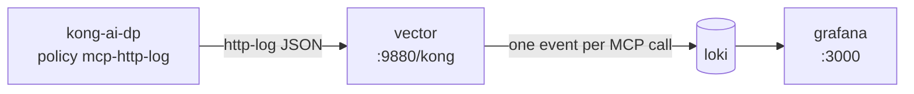

1. Start the stack:
   ```bash
   docker compose --profile observability up -d
   ```
2. Create the `mcp-http-log` policy and attach it to `pyats-tools`:
   ```bash
   ./konnect/create-mcp-observability.sh
   ```
3. Use the MCP server (Claude Code, step 4a, or `./keycloak/test-mcp-acl.sh`),
   then open http://localhost:3000. The **MCP tool usage (Kong AI Gateway)**
   dashboard is the home page; anyone can view it, and `admin` / `admin`
   can edit.

Each event has:

| Field | Meaning |
|---|---|
| time | When Kong received the request |
| `user` | Keycloak `preferred_username` (the `X-Authenticated-User` header), `anonymous` without a token |
| `role` | AI Consumer, from `mcp_role` |
| `method`, `tool` | JSON-RPC method (`tools/call`, `tools/list`, ...) and tool name |
| `action` | `allow`, `deny` (blocked by a tool ACL, 403, never reaches pyATS) or `reject` (401, no valid token) |
| `status`, `latency_ms` | HTTP status Kong returned; time pyATS took to answer |
| `arguments`, `request` | Tool arguments; the inbound JSON-RPC request |
| `response`, `result` | The outbound JSON-RPC reply; the tool's text output |
| `is_error`, `error` | JSON-RPC error or `isError` in the tool result |

`job`, `method`, `tool`, `action`, `role` and `user` are Loki labels, the
rest is in the JSON line. For ad-hoc queries, use Grafana's **Explore** with
for example `{job="kong-mcp", method="tools/call", user="netops-viewer-user"} | json`.
Kong redacts the `Authorization` header before logging, so tokens are never
stored. A denied call has no request or reply in its event: Kong blocks it
before it reaches pyATS, and the AI Gateway logs only the decision and the
tool name.

The dashboard: totals (tool calls, denied, tool errors, active users, 401s),
calls over time by tool and by user, a who-called-what table, latency per
tool, a table of every call with its arguments and result, and a log panel
with each inbound request and outbound reply (expand a line for all fields).
Filter with the **User**, **Role**, **Tool** and **Decision** variables.

**If no events arrive:** `docker logs kong-ai-dp | grep http-log`. A
"connection refused" for `vector:9880` after recreating the `vector`
container means Kong still has its old IP address cached; restart
`kong-ai-dp` or wait for the DNS entry to expire. Konnect takes a few
seconds to push the policy to the data plane.

To stop sending logs, run `./konnect/create-mcp-observability.sh remove`,
then `docker compose --profile observability down` (add `-v` to delete the
stored events and Grafana's state).

## How the observability stack works

New to Vector and Loki? This section explains what each piece does, how
they connect, and where to look when you want to see what's going on.

### The short version

Think of a parcel service:

| Piece | Role in one line | Analogy |
|---|---|---|
| **Kong AI Gateway** | Writes a log record for every MCP request | The shop that hands over parcels |
| **Vector** | Receives the records, reshapes them, forwards them | The sorting center: opens, relabels, sends on |
| **Loki** | Stores the events and answers questions about them | The warehouse with an index |
| **Grafana** | Shows the events as dashboards and lets you search them | The front desk where you ask "where's my parcel?" |

Vector never keeps anything, Loki never draws anything, and Grafana never
stores anything. Each one does one job.

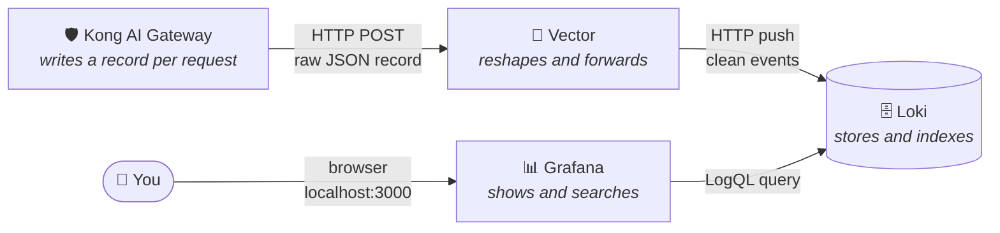

### What happens when someone calls a tool

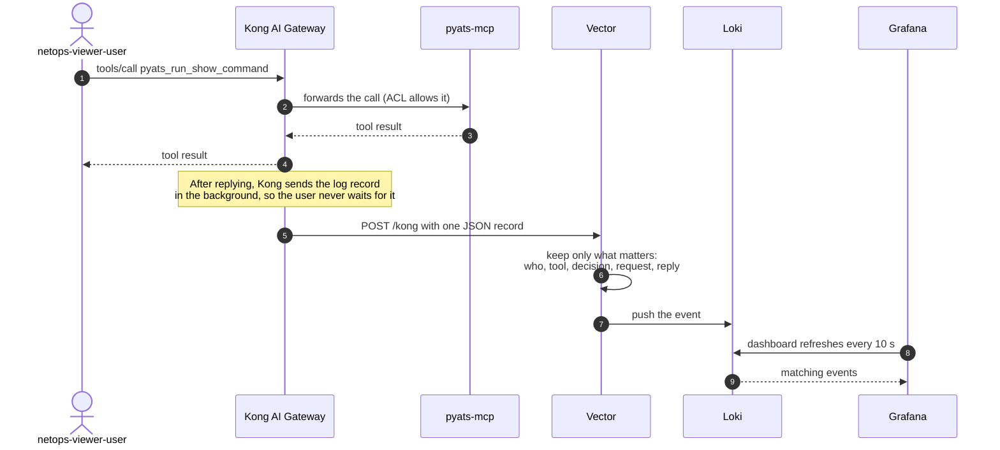

### Vector: the sorting center

Vector is a small program that moves data from A to B and can change it on
the way. Every Vector config has the same three parts, and ours is
[observability/vector.yaml](observability/vector.yaml):

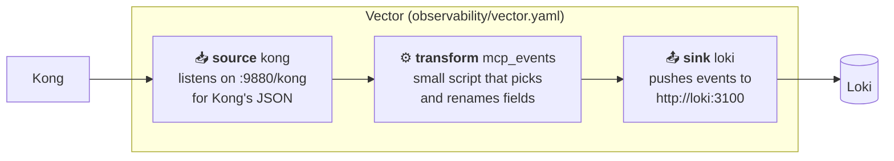

- **Source:** where data comes in. Here, an HTTP endpoint that Kong posts to.
- **Transform:** what happens to it. Kong's record is large and nested. The
  script, written in Vector's language VRL, pulls out the user, role, tool,
  decision, latency, request and reply. One Kong record can hold several MCP
  calls, so it can become several events.
- **Sink:** where data goes out. Here, Loki.

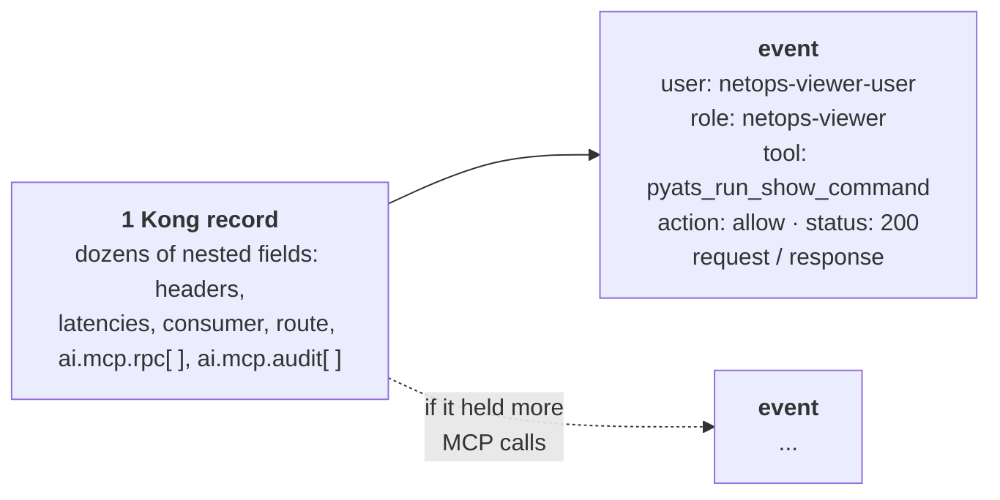

### Loki: the warehouse

Loki is a database built for logs. Its main trick is that it splits every
event into two parts:

- **Labels**: a few short tags (`user`, `role`, `tool`, `action`, `method`,
  `job`). Loki indexes these, so filtering on them is fast. Think of them as
  the label on the outside of a box.
- **The log line**: the full JSON event, including the request and reply.
  It isn't indexed. Loki reads it only for the events the labels already
  matched. This is the contents of the box.

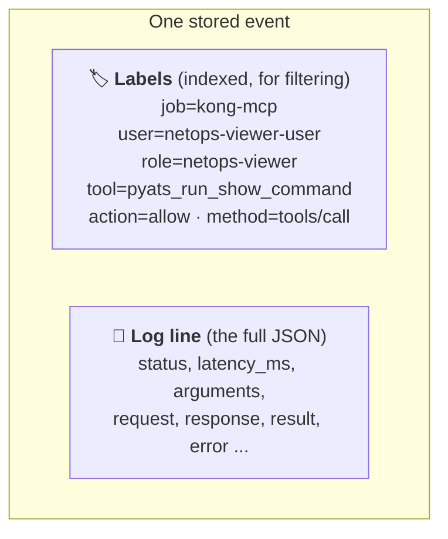

You ask Loki questions in **LogQL**. A query always starts with labels in
`{ }`, and can then dig into the JSON:

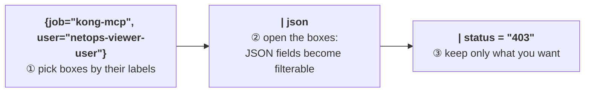

A few queries to try in Grafana's **Explore**:

| Question | LogQL |
|---|---|
| Everything one user did | `{job="kong-mcp", user="netops-viewer-user"}` |
| Every denied tool call | `{job="kong-mcp", action="deny"}` |
| Calls to one tool, with fields unpacked | `{job="kong-mcp", tool="pyats_run_show_command"} \| json` |
| Calls slower than 5 seconds | `{job="kong-mcp", method="tools/call"} \| json \| latency_ms > 5000` |
| Tool calls per user in the last hour | `sum by (user) (count_over_time({job="kong-mcp", method="tools/call"}[1h]))` |

### Grafana: the front desk

Grafana is the only one with a web UI: http://localhost:3000 (`admin` /
`admin`, or just view without logging in). Two places matter:

- **Dashboards → Kong AI Gateway → MCP tool usage**: the ready-made view.
  Every panel is a saved LogQL query. Open a panel's menu → **Edit** to see
  its query.
- **Explore** (compass icon in the left menu) → data source **Loki**:
  write your own queries. Click an event to see all its fields.

Grafana's settings come from files, so nothing is clicked together by hand:

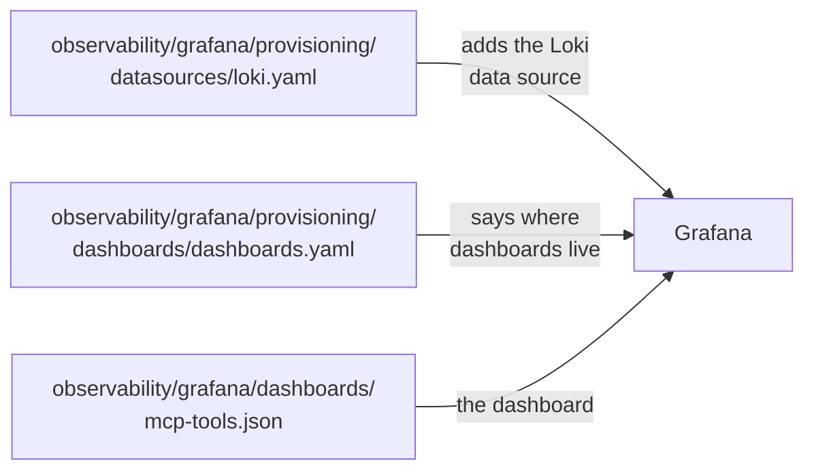

### One tool call, four shapes

Follow one real call, `netops-viewer-user` running `show clock` on R1, as
it moves through the pipeline. The data changes shape at every step:

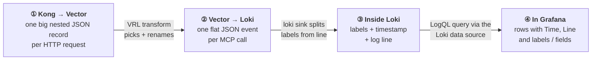

The log records don't pass through Konnect. The local data plane,
`kong-ai-dp`, sends them straight to Vector. Konnect only holds the
`mcp-http-log` policy that tells the data plane where to send them.

#### ① What Kong sends to Vector

The `http-log` policy POSTs one JSON record per HTTP request to
`http://vector:9880/kong`. It's Kong's standard log record (request,
response, latencies, consumer, route, service) plus an `ai.mcp` section the
AI Gateway adds for MCP traffic. Abridged; `◀` marks what Vector uses:

```jsonc
{
  "started_at": 1792420132861,                       // ◀ when (ms since epoch)
  "client_ip": "192.168.65.1",                       // ◀
  "consumer": { "username": "netops-viewer", "id": "c4329c63-…" },   // ◀ role
  "request": {
    "method": "POST", "uri": "/pyats-tools", "size": 1788,
    "headers": {
      "authorization": "REDACTED",                   // Kong never logs the token
      "x-authenticated-user": "netops-viewer-user",  // ◀ who
      "x-consumer-username": "netops-viewer",
      "mcp-session-id": "730c63ba3c864d7d8dc447b91bb3c50a",
      "user-agent": "curl/8.7.1"
    }
  },
  "response": {
    "status": 200,                                   // ◀
    "headers": { "x-kong-request-id": "4c351702abff7c630e74a644c17ea369", … }  // ◀
  },
  "latencies": { "request": 14127, "proxy": 3, "kong": 2, … },
  "route": { "name": "pyats-tools-route", … },
  "service": { "name": "pyats-tools", "host": "pyats-mcp", "port": 8000, … },
  "ai": {
    "mcp": {
      "mcp_session_id": "730c63ba3c864d7d8dc447b91bb3c50a",           // ◀
      "audit": [                                     // ◀ the ACL decision
        { "action": "allow", "primitive": "tool",
          "primitive_name": "pyats_run_show_command",
          "consumer": { "name": "netops-viewer", … } }
      ],
      "rpc": [                                       // ◀ one entry per JSON-RPC call
        {
          "id": "3", "method": "tools/call",
          "tool_name": "pyats_run_show_command",
          "latency": 14126, "response_body_size": 415,
          "payload": {                               // because the MCP server has logging.payloads on
            "request":  "{\"method\":\"tools/call\",\"id\":3,\"params\":{\"arguments\":{\"device_name\":\"R1\",\"command\":\"show clock\"},\"name\":\"pyats_run_show_command\"},\"jsonrpc\":\"2.0\"}",
            "response": "{\"jsonrpc\":\"2.0\",\"id\":3,\"result\":{\"content\":[{\"type\":\"text\",\"text\":\"{\\n  \\\"status\\\": \\\"completed\\\", … \\\"raw_output\\\": \\\"*14:28:56.590 UTC Mon Oct 19 2026\\\"\\n}\"}], … ,\"isError\":false}}"
          }
        }
      ]
    }
  },
  "tries": […], "workspace_name": "default", …
}
```

Things to notice:
- The request and reply are JSON **inside a string**, which is why they're
  full of `\"`.
- A **denied** call has an `audit` entry with `"action": "deny"` and no
  `rpc`, because Kong answered 403 itself. A request **without a token**
  has no `ai` section at all, just `"response": {"status": 401}`.
- When it receives the record, Vector adds `timestamp`, `path` and
  `source_type`. These fields don't come from Kong.

#### ② What Vector sends to Loki

The `mcp_events` transform turns the record into one flat event per `rpc`
entry. It keeps the fields above, unpacks the tool arguments and the
tool's text output, and adds a `level`:

```json
{
  "timestamp": "2026-10-19T14:28:52.861Z",
  "user": "netops-viewer-user",
  "role": "netops-viewer",
  "session": "730c63ba3c864d7d8dc447b91bb3c50a",
  "method": "tools/call",
  "tool": "pyats_run_show_command",
  "rpc_id": "3",
  "action": "allow",
  "status": 200,
  "latency_ms": 14126,
  "arguments": "{\"command\":\"show clock\",\"device_name\":\"R1\"}",
  "request": "{\"method\":\"tools/call\",\"id\":3,\"params\":{\"arguments\":{\"device_name\":\"R1\",\"command\":\"show clock\"},\"name\":\"pyats_run_show_command\"},\"jsonrpc\":\"2.0\"}",
  "response": "{\"jsonrpc\":\"2.0\",\"id\":3,\"result\":{\"content\":[{\"type\":\"text\",\"text\":\"…\"}],…,\"isError\":false}}",
  "result": "{\n  \"status\": \"completed\",\n  \"device\": \"R1\",\n  \"command\": \"show clock\",\n  \"raw_output\": \"*14:28:56.590 UTC Mon Oct 19 2026\"\n}",
  "is_error": false,
  "error": null,
  "level": "info",
  "client_ip": "192.168.65.1",
  "kong_request_id": "4c351702abff7c630e74a644c17ea369"
}
```

`level` is `info`, `warn` for a denied or rejected call, or `error` when the
tool failed. Without it, Loki guesses a level by looking for words like
"error" in the line, and it would mark every event as an error because of
the `is_error` and `error` fields.

#### ③ How Loki stores it

The loki sink splits the event into the three things Loki stores: a
**stream** (the set of labels), a **timestamp** in nanoseconds, and the
**log line**. The labels are the ones listed under `labels:` in
[observability/vector.yaml](observability/vector.yaml). The line is the
whole event as JSON, minus `timestamp`. Querying Loki's API directly shows
exactly that:

```json
{
  "stream": {
    "job": "kong-mcp",
    "mcp_server": "pyats-tools",
    "method": "tools/call",
    "tool": "pyats_run_show_command",
    "action": "allow",
    "role": "netops-viewer",
    "user": "netops-viewer-user",
    "service_name": "kong-mcp",
    "detected_level": "info"
  },
  "values": [
    [ "1792420132861000000",
      "{\"action\":\"allow\",\"arguments\":\"{\\\"command\\\":\\\"show clock\\\",…}\",…,\"user\":\"netops-viewer-user\"}" ]
  ]
}
```

Loki adds two labels of its own: `service_name`, copied from `job`, and
`detected_level`, taken from the `level` field. Every distinct combination
of labels is a separate stream, which is why labels must stay few and short.
The request, reply and arguments live in the line.

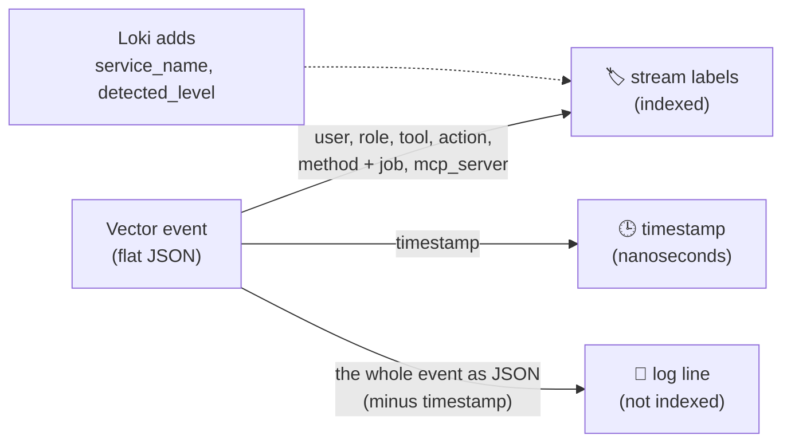

#### ④ How it looks in Grafana

Grafana reaches Loki through the **Loki data source**
([observability/grafana/provisioning/datasources/loki.yaml](observability/grafana/provisioning/datasources/loki.yaml),
URL `http://loki:3100`). A panel or an Explore query sends LogQL, and the
data source returns a table with **one row per log line**:

| Column | Example | What it is |
|---|---|---|
| `Time` | `2026-10-19 14:28:52.861` | The event timestamp |
| `Line` | `{"action":"allow","arguments":…}` | The log line, the JSON from ② |
| `labels` | `{"job":"kong-mcp","user":"netops-viewer-user",…}` | The stream labels, plus any fields the query extracted |
| `tsNs`, `id`, `labelTypes` | `1792420132861000000` | Internal: precise timestamp, row ID, label kinds |

Add `| json` to the query and Loki also unpacks the line, so every JSON
field shows up under `labels` and can be filtered on:

```logql
{job="kong-mcp", tool="pyats_run_show_command"} | json | latency_ms > 5000
```

```jsonc
// labels of the row, after "| json"
{
  "job": "kong-mcp", "mcp_server": "pyats-tools", "service_name": "kong-mcp",
  "detected_level": "info",
  "user": "netops-viewer-user", "user_extracted": "netops-viewer-user",
  "role": "netops-viewer",      "role_extracted": "netops-viewer",
  "tool": "pyats_run_show_command", "tool_extracted": "pyats_run_show_command",
  "action": "allow",            "action_extracted": "allow",
  "method": "tools/call",       "method_extracted": "tools/call",
  "status": "200", "latency_ms": "14126", "is_error": "false",
  "arguments": "{\"command\":\"show clock\",\"device_name\":\"R1\"}",
  "result": "{\n  \"status\": \"completed\", … }",
  "request": "…", "response": "…", "session": "…", "rpc_id": "3", …
}
```

Two things to notice:
- **Everything becomes a string.** `latency_ms > 5000` still works because
  LogQL converts numbers when you compare them.
- **`_extracted` suffixes.** When a JSON field has the same name as an
  existing label (`user`, `tool`, ...), Loki keeps the label and adds the
  JSON value as `<name>_extracted`. They hold the same value here.

How the dashboard uses this:

- **Counters and charts** like "Tool calls by user" use metric queries such
  as `sum by (user) (count_over_time({…, method="tools/call"}[$__auto]))`.
  Loki counts lines per label and returns numbers, not lines.
- **The "Tool calls" table** asks for raw lines. A Grafana transformation,
  *Extract fields* on the `Line` column, turns the JSON into columns.
  *Organize fields* then hides the ones you don't need and orders the rest
  (when, user, role, tool, action, status, latency, arguments, result).
- **The "Inbound request and outbound reply" panel** uses `| json |
  line_format "…"` to rewrite each line as
  `user (role) action tool -> status`, followed by the request and the
  response. Click a line to see all its fields.
- In **Explore**, pick the Loki data source, run
  `{job="kong-mcp"} | json`, and click any line. *Log details* lists every
  label and field, with buttons to filter on a value or exclude it.

### Where to look

Vector and Loki have no web UI. You see their configs as files and their
state through logs or HTTP endpoints. Loki's port isn't published to your
laptop, so reach it from a container on the Docker network.

| I want to... | Do this |
|---|---|
| See Vector's config | Open [observability/vector.yaml](observability/vector.yaml) |
| Check Vector is receiving and forwarding | `docker logs vector` (it only prints problems) |
| Check Kong is sending | `docker logs kong-ai-dp \| grep http-log` (no output means no errors) |
| See Loki's config file | `docker exec loki cat /etc/loki/local-config.yaml` |
| See Loki's full config, defaults included | `docker run --rm --network kong-workshop curlimages/curl -s http://loki:3100/config` |
| Check Loki is up | same command with `http://loki:3100/ready` |
| List the labels Loki knows | same command with `http://loki:3100/loki/api/v1/labels` |
| Browse and search the events | Grafana → **Explore** → **Loki** |
| See how a dashboard panel is built | Grafana → panel menu → **Edit** |

## Reference

### What's in here

| Path | Purpose |
|---|---|
| [docker-compose.yml](docker-compose.yml) | `kong-ai-dp`, `keycloak` + `postgres`, `pyats-mcp`; `vector`, `loki`, `grafana` in the `observability` profile |
| [konnect/create-ai-gateway.sh](konnect/create-ai-gateway.sh) | Creates the AI Gateway in Konnect, the data plane certificate and the `AI_*` values in `.env` |
| [konnect/create-mcp-acl.sh](konnect/create-mcp-acl.sh) | Creates the `pyats-tools` MCP server, the `keycloak-kong` auth strategy, the two AI Consumers and the access rules |
| [konnect/create-mcp-observability.sh](konnect/create-mcp-observability.sh) | Creates the `mcp-http-log` policy and attaches it to `pyats-tools` (`remove` undoes it) |
| [observability/](observability/) | Vector pipeline, Grafana data source and the MCP dashboard |
| [keycloak/setup.sh](keycloak/setup.sh) | Creates the `kong` realm, `mcp-client`, the `mcp_role` claim and the two users |
| [keycloak/mcp-auth.sh](keycloak/mcp-auth.sh) | `login` / `status` / `logout`, and the `headers` helper Claude Code runs |
| [keycloak/test-mcp-acl.sh](keycloak/test-mcp-acl.sh) | Checks the rules through Kong as each user |
| [.mcp.json](.mcp.json), [.claude/settings.json](.claude/settings.json) | The `pyats` server for Claude Code, pre-approved |

### Ports

| Port | Service |
|---|---|
| 8010 / 8453 | AI Gateway proxy (http / https) |
| 8110 | AI Gateway status |
| 8080 | Keycloak (admin / admin) |

Loki (3100) and Vector (9880) are reachable only inside the Docker network.

### Debugging pyats-mcp directly

`pyats-mcp` isn't published on the host. Call it from a container on the
same network:

```bash
docker run --rm --network kong-workshop curlimages/curl -s -X POST \
  http://pyats-mcp:8000/mcp \
  -H 'Content-Type: application/json' -H 'Accept: application/json, text/event-stream' \
  -d '{"jsonrpc":"2.0","id":1,"method":"initialize","params":{"protocolVersion":"2025-06-18","capabilities":{},"clientInfo":{"name":"curl","version":"0"}}}'
```

### Undo / tear down

```bash
docker compose --profile observability down   # add -v to also delete Keycloak's database and the stored events
```

To remove the access control in Konnect, drop the `access` block and tools
from `pyats-tools` (UI or a PUT), then delete the `keycloak-kong` auth
strategy and the two AI Consumers.
