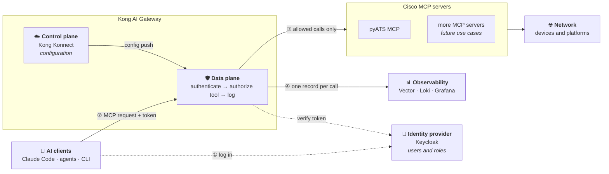
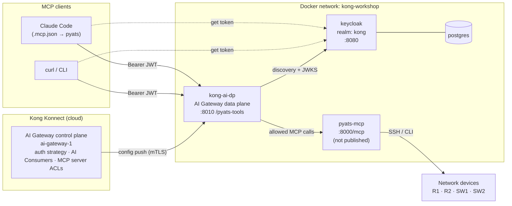
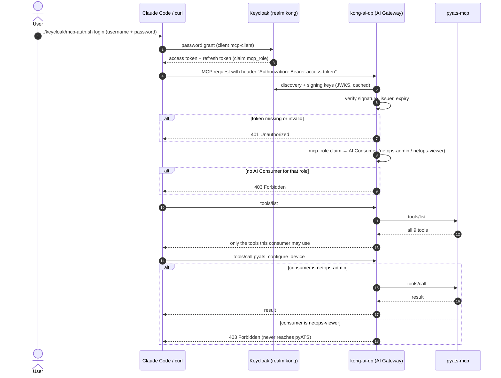

# NetOps with Kong AI Gateway and Cisco MCP servers

[](https://konghq.com/products/kong-ai-gateway)
[](https://cloud.konghq.com)
[](https://www.keycloak.org)
[](https://www.postgresql.org)
[](https://docs.docker.com/compose/)
[](https://modelcontextprotocol.io)
[](https://github.com/ponchotitlan/pyATS_MCP)
[](https://claude.com/claude-code)
[](https://openid.net/connect/)
[](https://vector.dev)
[](https://grafana.com/oss/loki/)
[](https://grafana.com/oss/grafana/)
[](https://www.gnu.org/software/bash/)

A proof of concept for running AI-driven network operations safely: Kong AI
Gateway sits between AI assistants and Cisco MCP servers and decides **who**
may use **which tools**, and records **what they did**. The first use case
is the [pyATS MCP server](https://github.com/ponchotitlan/pyATS_MCP).

**📖 Overview** · [🚀 Run it yourself](docs/run-it-yourself.md) · [📊 Observability](docs/observability.md)

- [Why this PoC](#why-this-poc)
- [General architecture](#general-architecture)
- [Use case: the pyATS MCP server](#use-case-the-pyats-mcp-server)
- [What's in here](#whats-in-here)
- [Next steps](#next-steps)

## Why this PoC

AI assistants such as Claude Code can now operate a network through **MCP
servers**. An MCP server exposes tools like "run a show command" or
"configure a device", and the model decides when to call them. That's
powerful, and it raises the questions every NetOps team asks about any
access to its devices:

| Question | Without a gateway | With Kong AI Gateway |
|---|---|---|
| **Who is calling?** | The MCP server usually doesn't know | Every request carries a token from the corporate identity provider |
| **What may they do?** | Every client sees every tool, including config changes | Each role sees and can call only its tools; the rest are blocked before they reach the server |
| **What happened?** | Scattered, per-server logs, if any | One record per tool call: when, who, which tool, arguments, reply, allowed or denied |

The goal of this PoC is to show that these controls can live **in the
gateway, not in each MCP server**. The MCP servers stay unchanged, users and
roles stay in the identity provider, and adding another MCP server means
reusing the same login, the same kind of rules and the same dashboards.

## General architecture



Every MCP request goes through the same four steps:

1. **Log in.** The user signs in to the identity provider and gets a token
   that names them and carries their role.
2. **Authenticate.** The gateway's data plane checks the token on every
   request. No valid token, no access.
3. **Authorize per tool.** The gateway maps the role to a set of allowed
   tools. It hides the other tools from the tool list and blocks calls to
   them, so they never reach the MCP server.
4. **Observe.** The gateway logs every call (who, tool, decision, request
   and reply) to the observability stack.

| Building block | Role | In this PoC |
|---|---|---|
| Identity provider | Owns users and roles, issues tokens | Keycloak (OpenID Connect) |
| Gateway control plane | Holds the configuration: MCP servers, login settings, roles, tool rules, log policies | Kong Konnect (cloud) |
| Gateway data plane | The only way in: enforces that configuration on every request | Kong AI Gateway container |
| MCP servers | Expose the actual tools; unchanged | pyATS MCP server |
| Observability | Collects, stores and shows the gateway's logs | Vector → Loki → Grafana |

The control plane and data plane are split: you configure in Konnect (UI or
API), and the data plane runs next to the MCP servers and receives that
configuration over mTLS. MCP traffic and its logs never pass through
Konnect.

## Use case: the pyATS MCP server

### The scenario

[Cisco pyATS](https://developer.cisco.com/pyats/) is Cisco's network test
and automation framework. The
[pyATS MCP server](https://github.com/ponchotitlan/pyATS_MCP) turns it into
nine MCP tools, from read-only ones like `show` commands to ones that change
the network, like pushing configuration.

A NetOps team has two kinds of people: **viewers**, who troubleshoot, and
**admins**, who may also change things. The gateway gives each role only
its tools:

| Role (`mcp_role` claim) | Keycloak user        | Tools                                                                                                                              |
|-------------------------|----------------------|------------------------------------------------------------------------------------------------------------------------------------|
| `netops-viewer`         | `netops-viewer-user` | `pyats_list_devices`, `pyats_run_show_command`, `pyats_show_running_config`, `pyats_show_logging`, `pyats_ping_from_network_device` |
| `netops-admin`          | `netops-admin-user`  | all of the above, plus `pyats_configure_device`, `pyats_run_linux_command`, `pyats_run_dynamic_test`, `pyats_load_external_inventory` |

Both users' password is `kong`. No token gets a 401; a valid token without a
known `mcp_role` gets a 403. As a viewer, Claude Code doesn't even see the
config tools, so asking it to change the network simply isn't possible.

### Deployment



- **Konnect** holds the configuration: the `pyats-tools` MCP server, the
  `keycloak-kong` auth strategy, the AI Consumers and the access rules. It
  pushes them to the data plane.
- **`kong-ai-dp`** is the only way in. It validates every request's token,
  works out the caller's role and enforces the tool rules before anything
  reaches pyATS.
- **Keycloak** issues tokens with an `mcp_role` claim. Users and their roles
  live only here.
- **`pyats-mcp`** isn't published on the host, so it can't be called
  without going through Kong.

### How it's implemented

#### 1. Identity: Keycloak

[keycloak/setup.sh](keycloak/setup.sh) creates:

- the **`kong` realm**, which holds the users;
- the public **`mcp-client`** client, which MCP clients use to log in;
- a mapper that copies each user's `mcp_role` attribute into an **`mcp_role`
  claim** in their access token;
- the two users, `netops-viewer-user` and `netops-admin-user`.

Roles live only in Keycloak. To give someone access, create them in the
`kong` realm with an `mcp_role` attribute of `netops-admin` or
`netops-viewer`. Nothing changes in Kong.

#### 2. Authentication and tool rules: Kong AI Gateway

[konnect/create-mcp-acl.sh](konnect/create-mcp-acl.sh) configures the AI
Gateway in Konnect. It's safe to re-run, and resets the access rules to the
ones below.

1. **MCP server `pyats-tools`**, created if missing: a passthrough listener
   on `/pyats-tools` forwarding to `http://pyats-mcp:8000/mcp`.
2. **Auth strategy `keycloak-kong`** (`openid-connect`): validates the bearer
   token against `http://keycloak:8080/realms/kong` and maps its `mcp_role`
   claim to the AI Consumer with that name (`consumer_claims: [["mcp_role"]]`,
   `consumer_by: username`, `consumer_optional: false`). It also copies the
   token's `preferred_username` into an `X-Authenticated-User` header on every
   request it forwards to pyATS (`upstream_headers_claims` /
   `upstream_headers_names`), so the MCP server knows which user made each
   tool call, not just their role. Kong replaces any `X-Authenticated-User`
   header the client sends with the value from the token, so it can't be
   faked.
3. **AI Consumers `netops-admin` and `netops-viewer`**: one per role.
4. **Access rules on `pyats-tools`**:
   ```yaml
   access:
     auth_strategies: [keycloak-kong]
     acl_attribute_type: consumer
     acls:              { allow: [netops-admin, netops-viewer] }   # who may connect
     default_tool_acls: { allow: [netops-admin, netops-viewer] }   # tools without their own rule
   tools:                                                           # replace the default per tool
     - { name: pyats_configure_device,        access: { acls: { allow: [netops-admin] } } }
     - { name: pyats_run_linux_command,       access: { acls: { allow: [netops-admin] } } }
     - { name: pyats_run_dynamic_test,        access: { acls: { allow: [netops-admin] } } }
     - { name: pyats_load_external_inventory, access: { acls: { allow: [netops-admin] } } }
   ```

To see it in the Konnect UI, go to **AI Gateway → ai_gateway_1**:

| Object | Where |
|---|---|
| Auth strategy | **Auth Strategies → Keycloak (kong realm)** |
| Consumers | **Consumers** → `netops-admin`, `netops-viewer` |
| Access rules | **MCP servers → pyATS Tools** → **ACLs** (attribute type, **Default tool ACL**) and **Tools** |

`pyats-tools` is a passthrough listener, so Konnect never stores the pyATS
tool list: **Tools** shows only the four tools with their own rule, and every
other tool falls under the default tool ACL. Tool names aren't checked
against the server, so a typo silently leaves that tool open to viewers.

#### 3. Connecting Claude Code

Users log in once with [keycloak/mcp-auth.sh](keycloak/mcp-auth.sh), and
Claude Code fetches a fresh token from it whenever it connects.

`./keycloak/mcp-auth.sh login` exchanges your password for an offline refresh
token and stores only that token in `~/.config/pyats-mcp/session` (mode
600), never the password. The `pyats` entry in [.mcp.json](.mcp.json) runs
`./keycloak/mcp-auth.sh headers` as its `headersHelper` on every connect,
trading the stored token for a fresh access token. If a call gets a 401 or
403, Claude Code runs the helper again and retries once. Claude Code runs
the helper without a terminal, so it can't prompt you; that's why `login` is
a separate step.

#### 4. Observability

[konnect/create-mcp-observability.sh](konnect/create-mcp-observability.sh)
attaches an `http-log` policy to `pyats-tools`, so the data plane sends a log
record for every MCP request to Vector. Vector turns each record into one
event per MCP call (who, role, tool, decision, request, reply) and stores it
in Loki, and a Grafana dashboard shows it. See
[the observability guide](docs/observability.md).

### Request flow



Every allow/deny decision is written to the AI Gateway's audit log.

### Design notes

#### Why consumers instead of matching the claim directly

The MCP server can match rules against a token claim directly
(`acl_attribute_type: oauth_access_token`). With this setup the gateway
rejected that with "access token claims not available"; it seems to need
the `access.metadata` OAuth setup. Mapping `mcp_role` to one AI Consumer per
role keeps Keycloak as the only place that assigns roles, with just two
objects in Kong. The trade-off: Konnect's analytics and logs show the role,
not the individual user. The user still reaches pyATS in the
`X-Authenticated-User` header (see [Authentication and tool rules](#2-authentication-and-tool-rules-kong-ai-gateway)).

#### Keycloak issuer

`KC_HOSTNAME=http://localhost:8080` pins the token issuer to the host-facing
URL, so a token fetched from the laptop validates in Kong, which reaches
Keycloak as `keycloak:8080`. `KC_HOSTNAME_BACKCHANNEL_DYNAMIC=true` keeps
`jwks_uri` / `token_endpoint` on whatever host was used:

```bash
docker run --rm --network kong-workshop curlimages/curl -s \
  http://keycloak:8080/realms/kong/.well-known/openid-configuration | jq '{issuer, jwks_uri}'
# issuer   => http://localhost:8080/realms/kong
# jwks_uri => http://keycloak:8080/realms/kong/protocol/openid-connect/certs
```

## What's in here

| Path | Purpose |
|---|---|
| [docker-compose.yml](docker-compose.yml) | `kong-ai-dp`, `keycloak` + `postgres`, `pyats-mcp`; `vector`, `loki`, `grafana` in the `observability` profile |
| [konnect/create-ai-gateway.sh](konnect/create-ai-gateway.sh) | Creates the AI Gateway in Konnect, the data plane certificate and the `AI_*` values in `.env` |
| [konnect/create-mcp-acl.sh](konnect/create-mcp-acl.sh) | Creates the `pyats-tools` MCP server, the `keycloak-kong` auth strategy, the two AI Consumers and the access rules |
| [konnect/create-mcp-observability.sh](konnect/create-mcp-observability.sh) | Creates the `mcp-http-log` policy and attaches it to `pyats-tools` (`remove` undoes it) |
| [observability/](observability/) | Vector pipeline, Grafana data source and the MCP dashboard |
| [docs/run-it-yourself.md](docs/run-it-yourself.md) | Setup steps, ports, debugging, tear-down |
| [docs/observability.md](docs/observability.md) | How the Vector → Loki → Grafana stack works, with real log examples |
| [keycloak/setup.sh](keycloak/setup.sh) | Creates the `kong` realm, `mcp-client`, the `mcp_role` claim and the two users |
| [keycloak/mcp-auth.sh](keycloak/mcp-auth.sh) | `login` / `status` / `logout`, and the `headers` helper Claude Code runs |
| [keycloak/test-mcp-acl.sh](keycloak/test-mcp-acl.sh) | Checks the rules through Kong as each user |
| [.mcp.json](.mcp.json), [.claude/settings.json](.claude/settings.json) | The `pyats` server for Claude Code, pre-approved |

## Next steps

| Document | What's in it |
|---|---|
| [🚀 Run it yourself](docs/run-it-yourself.md) | Prerequisites, then step by step: create the AI Gateway, set up Keycloak, protect the MCP server, use it from the CLI and Claude Code, and turn on observability. Also ports, debugging and tear-down. |
| [📊 Observability](docs/observability.md) | What Vector, Loki and Grafana each do, what an MCP event contains, the dashboard, and one real tool call followed from Kong's log record to a Grafana panel. |
