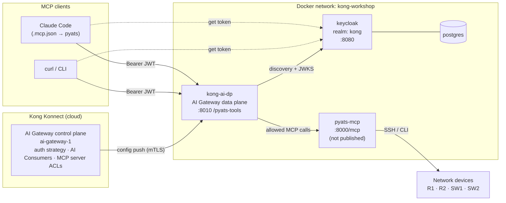
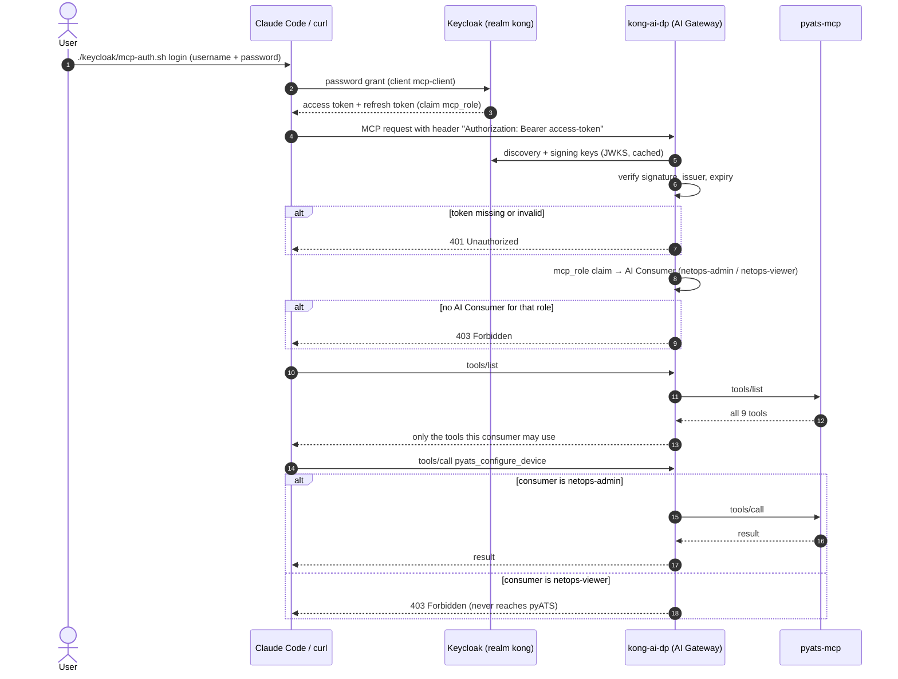

# Kong AI Gateway: Keycloak auth and MCP tool authorization

[](https://konghq.com/products/kong-ai-gateway)
[](https://cloud.konghq.com)
[](https://www.keycloak.org)
[](https://www.postgresql.org)
[](https://docs.docker.com/compose/)
[](https://modelcontextprotocol.io)
[](https://github.com/ponchotitlan/pyATS_MCP)
[](https://claude.com/claude-code)
[](https://openid.net/connect/)
[](https://www.gnu.org/software/bash/)

Puts the [pyATS MCP server](https://github.com/ponchotitlan/pyATS_MCP) behind
Kong AI Gateway. Keycloak decides who the caller is; the AI Gateway decides
which MCP tools they may see and call.

| Role (`mcp_role` claim) | Keycloak user        | Tools                                                                                                                              |
|-------------------------|----------------------|------------------------------------------------------------------------------------------------------------------------------------|
| `netops-viewer`         | `netops-viewer-user` | `pyats_list_devices`, `pyats_run_show_command`, `pyats_show_running_config`, `pyats_show_logging`, `pyats_ping_from_network_device` |
| `netops-admin`          | `netops-admin-user`  | all of the above, plus `pyats_configure_device`, `pyats_run_linux_command`, `pyats_run_dynamic_test`, `pyats_load_external_inventory` |

Both users' password is `kong`. No token gets a 401; a valid token without a
known `mcp_role` gets a 403.

## Architecture



- **Konnect** holds the configuration: the `pyats-tools` MCP server, the
  `keycloak-kong` auth strategy, the AI Consumers and the access rules. It
  pushes them to the data plane.
- **`kong-ai-dp`** is the only way in. It validates every request's token,
  works out the caller's role and enforces the tool rules before anything
  reaches pyATS.
- **Keycloak** issues tokens with an `mcp_role` claim. Users and their roles
  live only here.
- **`pyats-mcp`** isn't published on the host, so it can't be called
  without going through Kong.

## Authentication and authorization flow



Every allow/deny decision is written to the AI Gateway's audit log.

## What's in here

| Path | Purpose |
|---|---|
| [docker-compose.yml](docker-compose.yml) | `kong-ai-dp`, `keycloak` + `postgres`, `pyats-mcp` |
| [konnect/create-ai-gateway.sh](konnect/create-ai-gateway.sh) | Creates the AI Gateway in Konnect, the data plane certificate and the `AI_*` values in `.env` |
| [konnect/create-mcp-acl.sh](konnect/create-mcp-acl.sh) | Creates the `pyats-tools` MCP server, the `keycloak-kong` auth strategy, the two AI Consumers and the access rules |
| [keycloak/setup.sh](keycloak/setup.sh) | Creates the `kong` realm, `mcp-client`, the `mcp_role` claim and the two users |
| [keycloak/mcp-auth.sh](keycloak/mcp-auth.sh) | `login` / `status` / `logout`, and the `headers` helper Claude Code runs |
| [keycloak/test-mcp-acl.sh](keycloak/test-mcp-acl.sh) | Checks the rules through Kong as each user |
| [.mcp.json](.mcp.json), [.claude/settings.json](.claude/settings.json) | The `pyats` server for Claude Code, pre-approved |

## Prerequisites

- Docker, `jq` and `curl`
- A Konnect account and a [Personal Access Token](https://cloud.konghq.com/global/account/tokens)
- The `pyats-mcp:latest` image, built from `../pyATS_MCP` with
  `docker compose build` there. It mounts `../pyATS_MCP/testbed.yaml`; set
  `PYATS_TESTBED_FILE` to use a different testbed.
- `cisco-ca.pem` in this directory: the corporate root CA that `kong-ai-dp`
  trusts for outbound HTTPS. It's git-ignored, so copy it in yourself. Off
  the corporate network, any valid PEM certificate will do.

## Step 1: Create the AI Gateway

1. Put your token in `.env` (see [.env.example](.env.example)):
   ```bash
   cp .env.example .env
   # edit .env: PAT=kpat_...
   ```
2. Create the AI Gateway and the data plane certificate:
   ```bash
   ./konnect/create-ai-gateway.sh
   ```
   `KONNECT_REGION` defaults to `eu`; set `us`, `au`, `in` or `me` to match
   the subdomain of your Konnect UI (`KONNECT_REGION=us ./konnect/create-ai-gateway.sh`).
   The script creates `ai-gateway-1` (or reuses it), generates
   `certs/kong-ai/tls.crt` / `tls.key`, registers the certificate, and writes
   `AI_GATEWAY_ID` and the `AI_KONNECT_*` endpoints into `.env`.
3. Start the containers:
   ```bash
   docker compose up -d
   ```
   If you previously `source`d `.env` in the same shell, `unset` the
   `AI_KONNECT_*` variables first: exported values win over `.env`, and the
   data plane would connect to the old cluster.
4. Check that the data plane registered:
   ```bash
   set -a; . ./.env; set +a
   curl -s https://eu.api.konghq.com/v1/ai-gateways/$AI_GATEWAY_ID/nodes \
     -H "Authorization: Bearer $PAT" | jq '.data[] | {hostname, version}'
   ```

| Port | Service |
|---|---|
| 8010 / 8453 | AI Gateway proxy (http / https) |
| 8110 | AI Gateway status |
| 8080 | Keycloak (admin / admin) |

## Step 2: Set up the Keycloak users

1. Wait for Keycloak to answer on `http://localhost:8080`, then:
   ```bash
   ./keycloak/setup.sh
   ```
   This creates the `kong` realm, the public `mcp-client` client (whose
   access tokens carry the `mcp_role` claim), and the two users. It's safe to
   re-run.
2. Check the users:
   - **Admin console:** open http://localhost:8080, log in as `admin` /
     `admin`, switch the realm dropdown from **master** to **kong**, then
     **Users**. A user's role is on its **Attributes** tab (`mcp_role`).
   - **CLI:**
     ```bash
     ADMIN=$(curl -s http://localhost:8080/realms/master/protocol/openid-connect/token \
       -d client_id=admin-cli -d username=admin -d password=admin -d grant_type=password | jq -r .access_token)
     curl -s "http://localhost:8080/admin/realms/kong/users?briefRepresentation=false" \
       -H "Authorization: Bearer $ADMIN" \
       | jq -r '.[] | [.username, (.attributes.mcp_role // ["-"])[0]] | @tsv'
     ```

To add a user, create them in the **kong** realm with an `mcp_role`
attribute of `netops-admin` or `netops-viewer`. Nothing changes in Kong.

## Step 3: Protect the MCP server

```bash
./konnect/create-mcp-acl.sh
```

This configures the AI Gateway in Konnect. It's safe to re-run, and resets
the access rules to the ones below.

1. **MCP server `pyats-tools`**, created if missing: a passthrough listener
   on `/pyats-tools` forwarding to `http://pyats-mcp:8000/mcp`.
2. **Auth strategy `keycloak-kong`** (`openid-connect`): validates the bearer
   token against `http://keycloak:8080/realms/kong` and maps its `mcp_role`
   claim to the AI Consumer with that name (`consumer_claims: [["mcp_role"]]`,
   `consumer_by: username`, `consumer_optional: false`). It also copies the
   token's `preferred_username` into an `X-Authenticated-User` header on every
   request it forwards to pyATS (`upstream_headers_claims` /
   `upstream_headers_names`), so the MCP server knows which user made each
   tool call, not just their role. Kong replaces any `X-Authenticated-User`
   header the client sends with the value from the token, so it can't be
   faked.
3. **AI Consumers `netops-admin` and `netops-viewer`**: one per role.
4. **Access rules on `pyats-tools`**:
   ```yaml
   access:
     auth_strategies: [keycloak-kong]
     acl_attribute_type: consumer
     acls:              { allow: [netops-admin, netops-viewer] }   # who may connect
     default_tool_acls: { allow: [netops-admin, netops-viewer] }   # tools without their own rule
   tools:                                                           # replace the default per tool
     - { name: pyats_configure_device,        access: { acls: { allow: [netops-admin] } } }
     - { name: pyats_run_linux_command,       access: { acls: { allow: [netops-admin] } } }
     - { name: pyats_run_dynamic_test,        access: { acls: { allow: [netops-admin] } } }
     - { name: pyats_load_external_inventory, access: { acls: { allow: [netops-admin] } } }
   ```

Then check all the cases at once:

```bash
./keycloak/test-mcp-acl.sh
```

Expected: no token → 401; the viewer sees 5 tools and gets 403 on
`pyats_configure_device`; the admin sees all 9.

### Where to find it in the Konnect UI

Under **AI Gateway → ai_gateway_1**:

| Object | Where |
|---|---|
| Auth strategy | **Auth Strategies → Keycloak (kong realm)** |
| Consumers | **Consumers** → `netops-admin`, `netops-viewer` |
| Access rules | **MCP servers → pyATS Tools** → **ACLs** (attribute type, **Default tool ACL**) and **Tools** |

`pyats-tools` is a passthrough listener, so Konnect never stores the pyATS
tool list: **Tools** shows only the four tools with their own rule, and every
other tool falls under the default tool ACL. Tool names aren't checked
against the server, so a typo silently leaves that tool open to viewers.

## Step 4a: Use it from the CLI

Every request needs `Authorization: Bearer <access token>`. MCP over HTTP is
a session: `initialize`, then `notifications/initialized`, then any number of
requests carrying the `Mcp-Session-Id` header the server returned.

1. Get a token for a user:
   ```bash
   TOKEN=$(curl -s http://localhost:8080/realms/kong/protocol/openid-connect/token \
     -d client_id=mcp-client -d grant_type=password \
     -d username=netops-viewer-user -d password=kong | jq -r .access_token)
   ```
   Or reuse your `mcp-auth.sh` login (see 4b):
   `TOKEN=$(./keycloak/mcp-auth.sh headers | jq -r .Authorization | cut -d' ' -f2)`
2. Open an MCP session through Kong:
   ```bash
   MCP=http://localhost:8010/pyats-tools
   H=(-H "Authorization: Bearer $TOKEN" -H 'Content-Type: application/json' -H 'Accept: application/json, text/event-stream')

   SESSION=$(curl -s -D - -o /dev/null "${H[@]}" $MCP \
     -d '{"jsonrpc":"2.0","id":1,"method":"initialize","params":{"protocolVersion":"2025-06-18","capabilities":{},"clientInfo":{"name":"curl","version":"0"}}}' \
     | awk 'tolower($1)=="mcp-session-id:" {print $2}' | tr -d '\r')
   curl -s "${H[@]}" -H "Mcp-Session-Id: $SESSION" $MCP -d '{"jsonrpc":"2.0","method":"notifications/initialized"}'
   ```
3. List the tools this user may see:
   ```bash
   curl -s "${H[@]}" -H "Mcp-Session-Id: $SESSION" $MCP \
     -d '{"jsonrpc":"2.0","id":2,"method":"tools/list"}' \
     | sed -n 's/^data: //p' | jq -r '.result.tools[].name'
   ```
4. Call an allowed tool:
   ```bash
   curl -s "${H[@]}" -H "Mcp-Session-Id: $SESSION" $MCP \
     -d '{"jsonrpc":"2.0","id":3,"method":"tools/call","params":{"name":"pyats_run_show_command","arguments":{"device_name":"R1","command":"show version"}}}' \
     | sed -n 's/^data: //p' | jq -r '.result.content[0].text | fromjson | .raw_output' | head -3
   ```
5. Try a config tool. As the viewer this prints `403` and the call never
   reaches pyATS. **As the admin it really applies the config**, creating
   `Loopback99` on R1:
   ```bash
   curl -s -o /dev/null -w '%{http_code}\n' "${H[@]}" -H "Mcp-Session-Id: $SESSION" $MCP \
     -d '{"jsonrpc":"2.0","id":4,"method":"tools/call","params":{"name":"pyats_configure_device","arguments":{"device_name":"R1","config_commands":"interface Loopback99"}}}'
   ```

The same commands work in bash and zsh. Repeat with
`username=netops-admin-user` to see all 9 tools.

## Step 4b: Use it from Claude Code

1. Log in once in a terminal, with any user from the **kong** realm:
   ```bash
   ./keycloak/mcp-auth.sh login     # prompts for username / password
   ./keycloak/mcp-auth.sh status    # Logged in as netops-viewer-user (mcp_role: netops-viewer)
   ```
2. Start `claude` in this directory (CLI or VS Code extension) and run
   `/mcp`. The `pyats` server shows as connected, with 5 tools for the viewer
   or 9 for the admin. [.claude/settings.json](.claude/settings.json)
   pre-approves it, so there's no approval prompt.
3. Ask something like *"List all interfaces of R1"*. As the viewer, a request
   to change config fails, because Claude Code never sees the config tools.
4. To switch user, run `login` again with the other user, then reconnect
   `pyats` from `/mcp`.
5. When you're done:
   ```bash
   ./keycloak/mcp-auth.sh logout    # revokes the session in Keycloak and deletes it locally
   ```

**How it works:** `login` exchanges your password for an offline refresh
token and stores only that token in `~/.config/pyats-mcp/session` (mode
600), never the password. The `pyats` entry in [.mcp.json](.mcp.json) runs
`./keycloak/mcp-auth.sh headers` as its `headersHelper` on every connect,
trading the stored token for a fresh access token. If a call gets a 401 or
403, Claude Code runs the helper again and retries once. Claude Code runs
the helper without a terminal, so it can't prompt you; that's why `login` is
a separate step.

**If `/mcp` shows the server as failed:**
- `./keycloak/mcp-auth.sh status` says "not logged in" or "session expired":
  run `login` again.
- The error mentions *Dynamic Client Registration*: Claude Code is using a
  server entry without the helper, so Kong answered 401 and Claude Code
  tried OAuth. Look for another entry pointing at the same URL with
  `claude mcp list`, and remove it.
- `claude mcp get pyats` says *Rejected*: remove `pyats` from
  `disabledMcpjsonServers` in your `.claude/settings.local.json`.

## Keycloak issuer note

`KC_HOSTNAME=http://localhost:8080` pins the token issuer to the host-facing
URL, so a token fetched from the laptop validates in Kong, which reaches
Keycloak as `keycloak:8080`. `KC_HOSTNAME_BACKCHANNEL_DYNAMIC=true` keeps
`jwks_uri` / `token_endpoint` on whatever host was used:

```bash
docker run --rm --network kong-workshop curlimages/curl -s \
  http://keycloak:8080/realms/kong/.well-known/openid-configuration | jq '{issuer, jwks_uri}'
# issuer   => http://localhost:8080/realms/kong
# jwks_uri => http://keycloak:8080/realms/kong/protocol/openid-connect/certs
```

## Why consumers instead of matching the claim directly

The MCP server can match rules against a token claim directly
(`acl_attribute_type: oauth_access_token`). With this setup the gateway
rejected that with "access token claims not available"; it seems to need
the `access.metadata` OAuth setup. Mapping `mcp_role` to one AI Consumer per
role keeps Keycloak as the only place that assigns roles, with just two
objects in Kong. The trade-off: Konnect's analytics and logs show the role,
not the individual user. The user still reaches pyATS in the
`X-Authenticated-User` header (see step 3).

## Debugging pyats-mcp directly

`pyats-mcp` isn't published on the host. Call it from a container on the
same network:

```bash
docker run --rm --network kong-workshop curlimages/curl -s -X POST \
  http://pyats-mcp:8000/mcp \
  -H 'Content-Type: application/json' -H 'Accept: application/json, text/event-stream' \
  -d '{"jsonrpc":"2.0","id":1,"method":"initialize","params":{"protocolVersion":"2025-06-18","capabilities":{},"clientInfo":{"name":"curl","version":"0"}}}'
```

## Undo / tear down

```bash
docker compose down        # add -v to also delete Keycloak's database
```

To remove the access control in Konnect, drop the `access` block and tools
from `pyats-tools` (UI or a PUT), then delete the `keycloak-kong` auth
strategy and the two AI Consumers.
