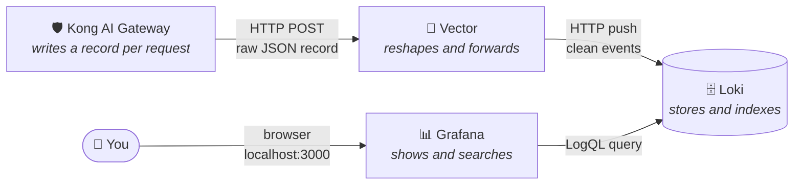
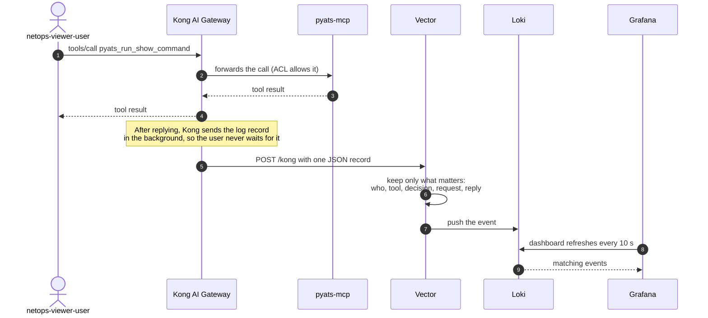
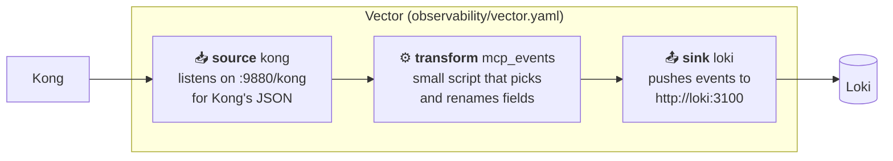
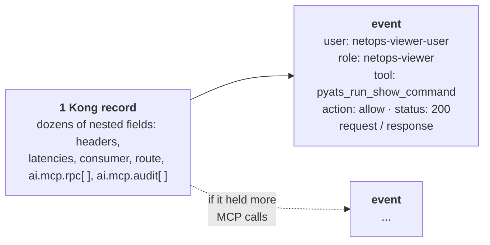
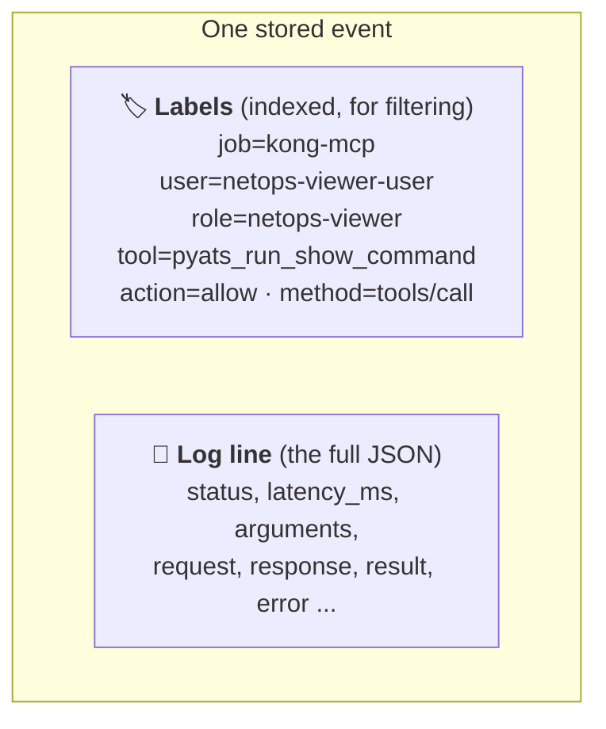
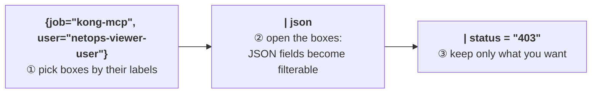
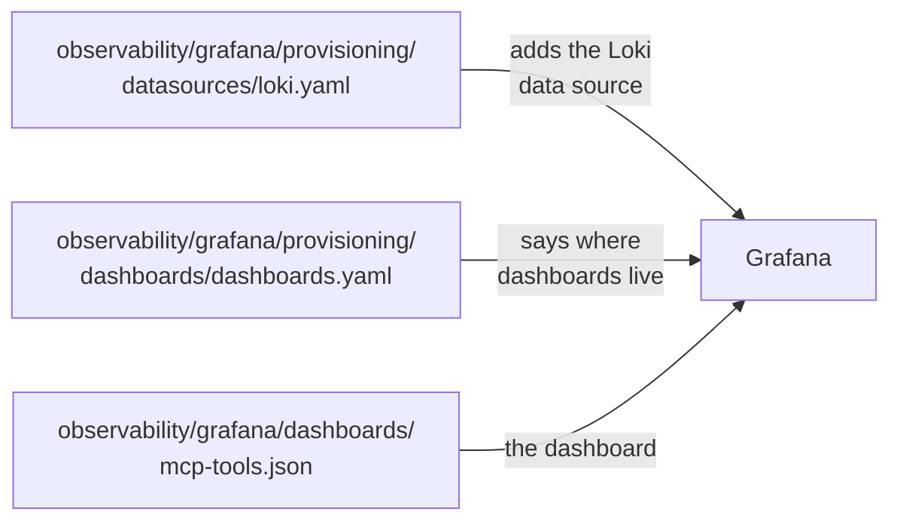
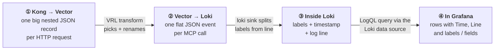
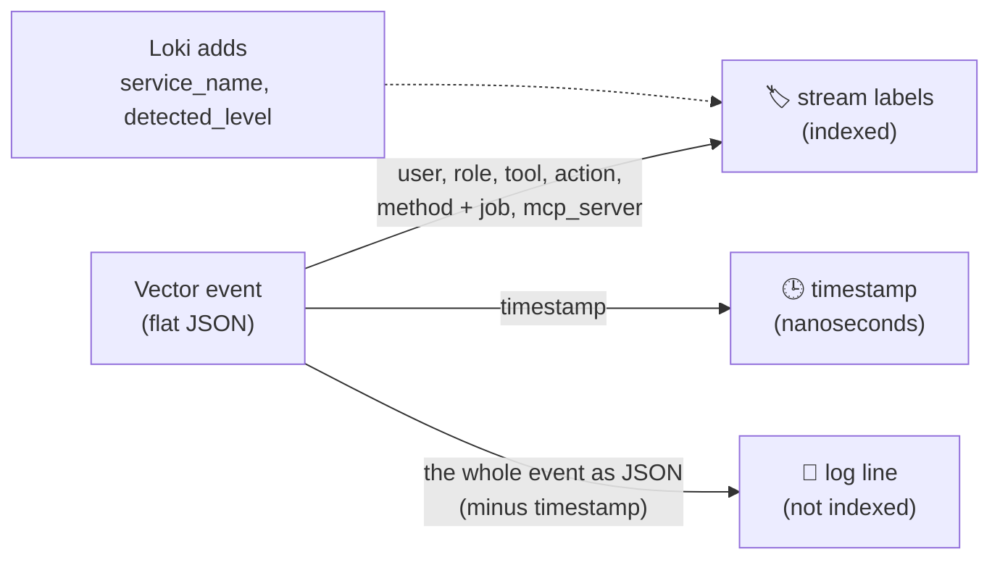

# Observability: who used which MCP tool

[📖 Overview](../README.md) · [🚀 Run it yourself](run-it-yourself.md) · **📊 Observability**

The AI Gateway logs every MCP request. This guide explains how those logs
reach a Grafana dashboard, what they contain, and how to explore them. To
switch it on, follow
[step 5 of Run it yourself](run-it-yourself.md#step-5-optional-observe-mcp-tool-use-in-grafana).

- [What's in an event](#whats-in-an-event)
- [The dashboard](#the-dashboard)
- [How the observability stack works](#how-the-observability-stack-works)
  - [The short version](#the-short-version)
  - [What happens when someone calls a tool](#what-happens-when-someone-calls-a-tool)
  - [Vector: the sorting center](#vector-the-sorting-center)
  - [Loki: the warehouse](#loki-the-warehouse)
  - [Grafana: the front desk](#grafana-the-front-desk)
  - [One tool call, four shapes](#one-tool-call-four-shapes)
  - [Where to look](#where-to-look)

## What's in an event

Each event Vector stores in Loki has:

| Field | Meaning |
|---|---|
| time | When Kong received the request |
| `user` | Keycloak `preferred_username` (the `X-Authenticated-User` header), `anonymous` without a token |
| `role` | AI Consumer, from `mcp_role` |
| `method`, `tool` | JSON-RPC method (`tools/call`, `tools/list`, ...) and tool name |
| `action` | `allow`, `deny` (blocked by a tool ACL, 403, never reaches pyATS) or `reject` (401, no valid token) |
| `status`, `latency_ms` | HTTP status Kong returned; time pyATS took to answer |
| `arguments`, `request` | Tool arguments; the inbound JSON-RPC request |
| `response`, `result` | The outbound JSON-RPC reply; the tool's text output |
| `is_error`, `error` | JSON-RPC error or `isError` in the tool result |
| `level` | `info`, `warn` (denied or rejected) or `error` (the tool failed) |

`job`, `method`, `tool`, `action`, `role` and `user` are Loki labels, the
rest is in the JSON line. For ad-hoc queries, use Grafana's **Explore** with
for example `{job="kong-mcp", method="tools/call", user="netops-viewer-user"} | json`.
Kong redacts the `Authorization` header before logging, so tokens are never
stored. A denied call has no request or reply in its event: Kong blocks it
before it reaches pyATS, and the AI Gateway logs only the decision and the
tool name.

## The dashboard

The dashboard: totals (tool calls, denied, tool errors, active users, 401s),
calls over time by tool and by user, a who-called-what table, latency per
tool, a table of every call with its arguments and result, and a log panel
with each inbound request and outbound reply (expand a line for all fields).
Filter with the **User**, **Role**, **Tool** and **Decision** variables.

## How the observability stack works

New to Vector and Loki? This section explains what each piece does, how
they connect, and where to look when you want to see what's going on.

### The short version

Think of a parcel service:

| Piece | Role in one line | Analogy |
|---|---|---|
| **Kong AI Gateway** | Writes a log record for every MCP request | The shop that hands over parcels |
| **Vector** | Receives the records, reshapes them, forwards them | The sorting center: opens, relabels, sends on |
| **Loki** | Stores the events and answers questions about them | The warehouse with an index |
| **Grafana** | Shows the events as dashboards and lets you search them | The front desk where you ask "where's my parcel?" |

Vector never keeps anything, Loki never draws anything, and Grafana never
stores anything. Each one does one job.



### What happens when someone calls a tool



### Vector: the sorting center

Vector is a small program that moves data from A to B and can change it on
the way. Every Vector config has the same three parts, and ours is
[observability/vector.yaml](../observability/vector.yaml):



- **Source:** where data comes in. Here, an HTTP endpoint that Kong posts to.
- **Transform:** what happens to it. Kong's record is large and nested. The
  script, written in Vector's language VRL, pulls out the user, role, tool,
  decision, latency, request and reply. One Kong record can hold several MCP
  calls, so it can become several events.
- **Sink:** where data goes out. Here, Loki.



### Loki: the warehouse

Loki is a database built for logs. Its main trick is that it splits every
event into two parts:

- **Labels**: a few short tags (`user`, `role`, `tool`, `action`, `method`,
  `job`). Loki indexes these, so filtering on them is fast. Think of them as
  the label on the outside of a box.
- **The log line**: the full JSON event, including the request and reply.
  It isn't indexed. Loki reads it only for the events the labels already
  matched. This is the contents of the box.



You ask Loki questions in **LogQL**. A query always starts with labels in
`{ }`, and can then dig into the JSON:



A few queries to try in Grafana's **Explore**:

| Question | LogQL |
|---|---|
| Everything one user did | `{job="kong-mcp", user="netops-viewer-user"}` |
| Every denied tool call | `{job="kong-mcp", action="deny"}` |
| Calls to one tool, with fields unpacked | `{job="kong-mcp", tool="pyats_run_show_command"} \| json` |
| Calls slower than 5 seconds | `{job="kong-mcp", method="tools/call"} \| json \| latency_ms > 5000` |
| Tool calls per user in the last hour | `sum by (user) (count_over_time({job="kong-mcp", method="tools/call"}[1h]))` |

### Grafana: the front desk

Grafana is the only one with a web UI: http://localhost:3000 (`admin` /
`admin`, or just view without logging in). Two places matter:

- **Dashboards → Kong AI Gateway → MCP tool usage**: the ready-made view.
  Every panel is a saved LogQL query. Open a panel's menu → **Edit** to see
  its query.
- **Explore** (compass icon in the left menu) → data source **Loki**:
  write your own queries. Click an event to see all its fields.

Grafana's settings come from files, so nothing is clicked together by hand:



### One tool call, four shapes

Follow one real call, `netops-viewer-user` running `show clock` on R1, as
it moves through the pipeline. The data changes shape at every step:



The log records don't pass through Konnect. The local data plane,
`kong-ai-dp`, sends them straight to Vector. Konnect only holds the
`mcp-http-log` policy that tells the data plane where to send them.

#### ① What Kong sends to Vector

The `http-log` policy POSTs one JSON record per HTTP request to
`http://vector:9880/kong`. It's Kong's standard log record (request,
response, latencies, consumer, route, service) plus an `ai.mcp` section the
AI Gateway adds for MCP traffic. Abridged; `◀` marks what Vector uses:

```jsonc
{
  "started_at": 1792420132861,                       // ◀ when (ms since epoch)
  "client_ip": "192.168.65.1",                       // ◀
  "consumer": { "username": "netops-viewer", "id": "c4329c63-…" },   // ◀ role
  "request": {
    "method": "POST", "uri": "/pyats-tools", "size": 1788,
    "headers": {
      "authorization": "REDACTED",                   // Kong never logs the token
      "x-authenticated-user": "netops-viewer-user",  // ◀ who
      "x-consumer-username": "netops-viewer",
      "mcp-session-id": "730c63ba3c864d7d8dc447b91bb3c50a",
      "user-agent": "curl/8.7.1"
    }
  },
  "response": {
    "status": 200,                                   // ◀
    "headers": { "x-kong-request-id": "4c351702abff7c630e74a644c17ea369", … }  // ◀
  },
  "latencies": { "request": 14127, "proxy": 3, "kong": 2, … },
  "route": { "name": "pyats-tools-route", … },
  "service": { "name": "pyats-tools", "host": "pyats-mcp", "port": 8000, … },
  "ai": {
    "mcp": {
      "mcp_session_id": "730c63ba3c864d7d8dc447b91bb3c50a",           // ◀
      "audit": [                                     // ◀ the ACL decision
        { "action": "allow", "primitive": "tool",
          "primitive_name": "pyats_run_show_command",
          "consumer": { "name": "netops-viewer", … } }
      ],
      "rpc": [                                       // ◀ one entry per JSON-RPC call
        {
          "id": "3", "method": "tools/call",
          "tool_name": "pyats_run_show_command",
          "latency": 14126, "response_body_size": 415,
          "payload": {                               // because the MCP server has logging.payloads on
            "request":  "{\"method\":\"tools/call\",\"id\":3,\"params\":{\"arguments\":{\"device_name\":\"R1\",\"command\":\"show clock\"},\"name\":\"pyats_run_show_command\"},\"jsonrpc\":\"2.0\"}",
            "response": "{\"jsonrpc\":\"2.0\",\"id\":3,\"result\":{\"content\":[{\"type\":\"text\",\"text\":\"{\\n  \\\"status\\\": \\\"completed\\\", … \\\"raw_output\\\": \\\"*14:28:56.590 UTC Mon Oct 19 2026\\\"\\n}\"}], … ,\"isError\":false}}"
          }
        }
      ]
    }
  },
  "tries": […], "workspace_name": "default", …
}
```

Things to notice:
- The request and reply are JSON **inside a string**, which is why they're
  full of `\"`.
- A **denied** call has an `audit` entry with `"action": "deny"` and no
  `rpc`, because Kong answered 403 itself. A request **without a token**
  has no `ai` section at all, just `"response": {"status": 401}`.
- When it receives the record, Vector adds `timestamp`, `path` and
  `source_type`. These fields don't come from Kong.

#### ② What Vector sends to Loki

The `mcp_events` transform turns the record into one flat event per `rpc`
entry. It keeps the fields above, unpacks the tool arguments and the
tool's text output, and adds a `level`:

```json
{
  "timestamp": "2026-10-19T14:28:52.861Z",
  "user": "netops-viewer-user",
  "role": "netops-viewer",
  "session": "730c63ba3c864d7d8dc447b91bb3c50a",
  "method": "tools/call",
  "tool": "pyats_run_show_command",
  "rpc_id": "3",
  "action": "allow",
  "status": 200,
  "latency_ms": 14126,
  "arguments": "{\"command\":\"show clock\",\"device_name\":\"R1\"}",
  "request": "{\"method\":\"tools/call\",\"id\":3,\"params\":{\"arguments\":{\"device_name\":\"R1\",\"command\":\"show clock\"},\"name\":\"pyats_run_show_command\"},\"jsonrpc\":\"2.0\"}",
  "response": "{\"jsonrpc\":\"2.0\",\"id\":3,\"result\":{\"content\":[{\"type\":\"text\",\"text\":\"…\"}],…,\"isError\":false}}",
  "result": "{\n  \"status\": \"completed\",\n  \"device\": \"R1\",\n  \"command\": \"show clock\",\n  \"raw_output\": \"*14:28:56.590 UTC Mon Oct 19 2026\"\n}",
  "is_error": false,
  "error": null,
  "level": "info",
  "client_ip": "192.168.65.1",
  "kong_request_id": "4c351702abff7c630e74a644c17ea369"
}
```

`level` is `info`, `warn` for a denied or rejected call, or `error` when the
tool failed. Without it, Loki guesses a level by looking for words like
"error" in the line, and it would mark every event as an error because of
the `is_error` and `error` fields.

#### ③ How Loki stores it

The loki sink splits the event into the three things Loki stores: a
**stream** (the set of labels), a **timestamp** in nanoseconds, and the
**log line**. The labels are the ones listed under `labels:` in
[observability/vector.yaml](../observability/vector.yaml). The line is the
whole event as JSON, minus `timestamp`. Querying Loki's API directly shows
exactly that:

```json
{
  "stream": {
    "job": "kong-mcp",
    "mcp_server": "pyats-tools",
    "method": "tools/call",
    "tool": "pyats_run_show_command",
    "action": "allow",
    "role": "netops-viewer",
    "user": "netops-viewer-user",
    "service_name": "kong-mcp",
    "detected_level": "info"
  },
  "values": [
    [ "1792420132861000000",
      "{\"action\":\"allow\",\"arguments\":\"{\\\"command\\\":\\\"show clock\\\",…}\",…,\"user\":\"netops-viewer-user\"}" ]
  ]
}
```

Loki adds two labels of its own: `service_name`, copied from `job`, and
`detected_level`, taken from the `level` field. Every distinct combination
of labels is a separate stream, which is why labels must stay few and short.
The request, reply and arguments live in the line.



#### ④ How it looks in Grafana

Grafana reaches Loki through the **Loki data source**
([observability/grafana/provisioning/datasources/loki.yaml](../observability/grafana/provisioning/datasources/loki.yaml),
URL `http://loki:3100`). A panel or an Explore query sends LogQL, and the
data source returns a table with **one row per log line**:

| Column | Example | What it is |
|---|---|---|
| `Time` | `2026-10-19 14:28:52.861` | The event timestamp |
| `Line` | `{"action":"allow","arguments":…}` | The log line, the JSON from ② |
| `labels` | `{"job":"kong-mcp","user":"netops-viewer-user",…}` | The stream labels, plus any fields the query extracted |
| `tsNs`, `id`, `labelTypes` | `1792420132861000000` | Internal: precise timestamp, row ID, label kinds |

Add `| json` to the query and Loki also unpacks the line, so every JSON
field shows up under `labels` and can be filtered on:

```logql
{job="kong-mcp", tool="pyats_run_show_command"} | json | latency_ms > 5000
```

```jsonc
// labels of the row, after "| json"
{
  "job": "kong-mcp", "mcp_server": "pyats-tools", "service_name": "kong-mcp",
  "detected_level": "info",
  "user": "netops-viewer-user", "user_extracted": "netops-viewer-user",
  "role": "netops-viewer",      "role_extracted": "netops-viewer",
  "tool": "pyats_run_show_command", "tool_extracted": "pyats_run_show_command",
  "action": "allow",            "action_extracted": "allow",
  "method": "tools/call",       "method_extracted": "tools/call",
  "status": "200", "latency_ms": "14126", "is_error": "false",
  "arguments": "{\"command\":\"show clock\",\"device_name\":\"R1\"}",
  "result": "{\n  \"status\": \"completed\", … }",
  "request": "…", "response": "…", "session": "…", "rpc_id": "3", …
}
```

Two things to notice:
- **Everything becomes a string.** `latency_ms > 5000` still works because
  LogQL converts numbers when you compare them.
- **`_extracted` suffixes.** When a JSON field has the same name as an
  existing label (`user`, `tool`, ...), Loki keeps the label and adds the
  JSON value as `<name>_extracted`. They hold the same value here.

How the dashboard uses this:

- **Counters and charts** like "Tool calls by user" use metric queries such
  as `sum by (user) (count_over_time({…, method="tools/call"}[$__auto]))`.
  Loki counts lines per label and returns numbers, not lines.
- **The "Tool calls" table** asks for raw lines. A Grafana transformation,
  *Extract fields* on the `Line` column, turns the JSON into columns.
  *Organize fields* then hides the ones you don't need and orders the rest
  (when, user, role, tool, action, status, latency, arguments, result).
- **The "Inbound request and outbound reply" panel** uses `| json |
  line_format "…"` to rewrite each line as
  `user (role) action tool -> status`, followed by the request and the
  response. Click a line to see all its fields.
- In **Explore**, pick the Loki data source, run
  `{job="kong-mcp"} | json`, and click any line. *Log details* lists every
  label and field, with buttons to filter on a value or exclude it.

### Where to look

Vector and Loki have no web UI. You see their configs as files and their
state through logs or HTTP endpoints. Loki's port isn't published to your
laptop, so reach it from a container on the Docker network.

| I want to... | Do this |
|---|---|
| See Vector's config | Open [observability/vector.yaml](../observability/vector.yaml) |
| Check Vector is receiving and forwarding | `docker logs vector` (it only prints problems) |
| Check Kong is sending | `docker logs kong-ai-dp \| grep http-log` (no output means no errors) |
| See Loki's config file | `docker exec loki cat /etc/loki/local-config.yaml` |
| See Loki's full config, defaults included | `docker run --rm --network kong-workshop curlimages/curl -s http://loki:3100/config` |
| Check Loki is up | same command with `http://loki:3100/ready` |
| List the labels Loki knows | same command with `http://loki:3100/loki/api/v1/labels` |
| Browse and search the events | Grafana → **Explore** → **Loki** |
| See how a dashboard panel is built | Grafana → panel menu → **Edit** |

---

[📖 Overview](../README.md) · [🚀 Run it yourself](run-it-yourself.md) · **📊 Observability**
