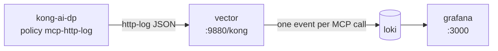

# Run it yourself

[📖 Overview](../README.md) · **🚀 Run it yourself** · [📊 Observability](observability.md)

Set up the PoC described in the [overview](../README.md) on your laptop:
Kong AI Gateway in front of the pyATS MCP server, users in Keycloak, and
optionally the observability stack. Run every command from the repository
root.

- [Prerequisites](#prerequisites)
- [Step 1: Create the AI Gateway](#step-1-create-the-ai-gateway)
- [Step 2: Set up the Keycloak users](#step-2-set-up-the-keycloak-users)
- [Step 3: Protect the MCP server](#step-3-protect-the-mcp-server)
- [Step 4a: Use it from the CLI](#step-4a-use-it-from-the-cli)
- [Step 4b: Use it from Claude Code](#step-4b-use-it-from-claude-code)
- [Step 5 (optional): Observe MCP tool use in Grafana](#step-5-optional-observe-mcp-tool-use-in-grafana)
- [Ports](#ports)
- [Debugging pyats-mcp directly](#debugging-pyats-mcp-directly)
- [Undo / tear down](#undo--tear-down)

## Prerequisites

- Docker, `jq` and `curl`
- A Konnect account and a [Personal Access Token](https://cloud.konghq.com/global/account/tokens)
- The `pyats-mcp:latest` image, built from `../pyATS_MCP` with
  `docker compose build` there. It mounts `../pyATS_MCP/testbed.yaml`; set
  `PYATS_TESTBED_FILE` to use a different testbed.
- `cisco-ca.pem` in this directory: the corporate root CA that `kong-ai-dp`
  trusts for outbound HTTPS. It's git-ignored, so copy it in yourself. Off
  the corporate network, any valid PEM certificate will do.

## Step 1: Create the AI Gateway

1. Put your token in `.env` (see [.env.example](../.env.example)):
   ```bash
   cp .env.example .env
   # edit .env: PAT=kpat_...
   ```
2. Create the AI Gateway and the data plane certificate:
   ```bash
   ./konnect/create-ai-gateway.sh
   ```
   `KONNECT_REGION` defaults to `eu`; set `us`, `au`, `in` or `me` to match
   the subdomain of your Konnect UI (`KONNECT_REGION=us ./konnect/create-ai-gateway.sh`).
   The script creates `ai-gateway-1` (or reuses it), generates
   `certs/kong-ai/tls.crt` / `tls.key`, registers the certificate, and writes
   `AI_GATEWAY_ID` and the `AI_KONNECT_*` endpoints into `.env`.
3. Start the containers:
   ```bash
   docker compose up -d
   ```
   If you previously `source`d `.env` in the same shell, `unset` the
   `AI_KONNECT_*` variables first: exported values win over `.env`, and the
   data plane would connect to the old cluster.
4. Check that the data plane registered:
   ```bash
   set -a; . ./.env; set +a
   curl -s https://eu.api.konghq.com/v1/ai-gateways/$AI_GATEWAY_ID/nodes \
     -H "Authorization: Bearer $PAT" | jq '.data[] | {hostname, version}'
   ```

## Step 2: Set up the Keycloak users

1. Wait for Keycloak to answer on `http://localhost:8080`, then:
   ```bash
   ./keycloak/setup.sh
   ```
   This creates the `kong` realm, the public `mcp-client` client (whose
   access tokens carry the `mcp_role` claim), and the two users. It's safe to
   re-run.
2. Check the users:
   - **Admin console:** open http://localhost:8080, log in as `admin` /
     `admin`, switch the realm dropdown from **master** to **kong**, then
     **Users**. A user's role is on its **Attributes** tab (`mcp_role`).
   - **CLI:**
     ```bash
     ADMIN=$(curl -s http://localhost:8080/realms/master/protocol/openid-connect/token \
       -d client_id=admin-cli -d username=admin -d password=admin -d grant_type=password | jq -r .access_token)
     curl -s "http://localhost:8080/admin/realms/kong/users?briefRepresentation=false" \
       -H "Authorization: Bearer $ADMIN" \
       | jq -r '.[] | [.username, (.attributes.mcp_role // ["-"])[0]] | @tsv'
     ```

To add a user, create them in the **kong** realm with an `mcp_role`
attribute of `netops-admin` or `netops-viewer`. Nothing changes in Kong.

## Step 3: Protect the MCP server

```bash
./konnect/create-mcp-acl.sh
```

This creates the MCP server, the Keycloak auth strategy, the two AI
Consumers and the tool rules described in
[Authentication and tool rules](../README.md#2-authentication-and-tool-rules-kong-ai-gateway).
Then check all the cases at once:

```bash
./keycloak/test-mcp-acl.sh
```

Expected: no token → 401; the viewer sees 5 tools and gets 403 on
`pyats_configure_device`; the admin sees all 9.

## Step 4a: Use it from the CLI

Every request needs `Authorization: Bearer <access token>`. MCP over HTTP is
a session: `initialize`, then `notifications/initialized`, then any number of
requests carrying the `Mcp-Session-Id` header the server returned.

1. Get a token for a user:
   ```bash
   TOKEN=$(curl -s http://localhost:8080/realms/kong/protocol/openid-connect/token \
     -d client_id=mcp-client -d grant_type=password \
     -d username=netops-viewer-user -d password=kong | jq -r .access_token)
   ```
   Or reuse your `mcp-auth.sh` login (see 4b):
   `TOKEN=$(./keycloak/mcp-auth.sh headers | jq -r .Authorization | cut -d' ' -f2)`
2. Open an MCP session through Kong:
   ```bash
   MCP=http://localhost:8010/pyats-tools
   H=(-H "Authorization: Bearer $TOKEN" -H 'Content-Type: application/json' -H 'Accept: application/json, text/event-stream')

   SESSION=$(curl -s -D - -o /dev/null "${H[@]}" $MCP \
     -d '{"jsonrpc":"2.0","id":1,"method":"initialize","params":{"protocolVersion":"2025-06-18","capabilities":{},"clientInfo":{"name":"curl","version":"0"}}}' \
     | awk 'tolower($1)=="mcp-session-id:" {print $2}' | tr -d '\r')
   curl -s "${H[@]}" -H "Mcp-Session-Id: $SESSION" $MCP -d '{"jsonrpc":"2.0","method":"notifications/initialized"}'
   ```
3. List the tools this user may see:
   ```bash
   curl -s "${H[@]}" -H "Mcp-Session-Id: $SESSION" $MCP \
     -d '{"jsonrpc":"2.0","id":2,"method":"tools/list"}' \
     | sed -n 's/^data: //p' | jq -r '.result.tools[].name'
   ```
4. Call an allowed tool:
   ```bash
   curl -s "${H[@]}" -H "Mcp-Session-Id: $SESSION" $MCP \
     -d '{"jsonrpc":"2.0","id":3,"method":"tools/call","params":{"name":"pyats_run_show_command","arguments":{"device_name":"R1","command":"show version"}}}' \
     | sed -n 's/^data: //p' | jq -r '.result.content[0].text | fromjson | .raw_output' | head -3
   ```
5. Try a config tool. As the viewer this prints `403` and the call never
   reaches pyATS. **As the admin it really applies the config**, creating
   `Loopback99` on R1:
   ```bash
   curl -s -o /dev/null -w '%{http_code}\n' "${H[@]}" -H "Mcp-Session-Id: $SESSION" $MCP \
     -d '{"jsonrpc":"2.0","id":4,"method":"tools/call","params":{"name":"pyats_configure_device","arguments":{"device_name":"R1","config_commands":"interface Loopback99"}}}'
   ```

The same commands work in bash and zsh. Repeat with
`username=netops-admin-user` to see all 9 tools.

## Step 4b: Use it from Claude Code

1. Log in once in a terminal, with any user from the **kong** realm:
   ```bash
   ./keycloak/mcp-auth.sh login     # prompts for username / password
   ./keycloak/mcp-auth.sh status    # Logged in as netops-viewer-user (mcp_role: netops-viewer)
   ```
2. Start `claude` in this directory (CLI or VS Code extension) and run
   `/mcp`. The `pyats` server shows as connected, with 5 tools for the viewer
   or 9 for the admin. [.claude/settings.json](../.claude/settings.json)
   pre-approves it, so there's no approval prompt.
3. Ask something like *"List all interfaces of R1"*. As the viewer, a request
   to change config fails, because Claude Code never sees the config tools.
4. To switch user, run `login` again with the other user, then reconnect
   `pyats` from `/mcp`.
5. When you're done:
   ```bash
   ./keycloak/mcp-auth.sh logout    # revokes the session in Keycloak and deletes it locally
   ```

**If `/mcp` shows the server as failed:**
- `./keycloak/mcp-auth.sh status` says "not logged in" or "session expired":
  run `login` again.
- The error mentions *Dynamic Client Registration*: Claude Code is using a
  server entry without the helper, so Kong answered 401 and Claude Code
  tried OAuth. Look for another entry pointing at the same URL with
  `claude mcp list`, and remove it.
- `claude mcp get pyats` says *Rejected*: remove `pyats` from
  `disabledMcpjsonServers` in your `.claude/settings.local.json`.

How the login and token refresh work is described in
[Connecting Claude Code](../README.md#3-connecting-claude-code).

## Step 5 (optional): Observe MCP tool use in Grafana

The `observability` compose profile adds Vector, Loki and Grafana. An
`http-log` policy on `pyats-tools` makes the AI Gateway POST a log record
for every MCP request to Vector. Vector turns each record into one event per
JSON-RPC call and ships it to Loki, and Grafana shows them.



1. Start the stack:
   ```bash
   docker compose --profile observability up -d
   ```
2. Create the `mcp-http-log` policy and attach it to `pyats-tools`:
   ```bash
   ./konnect/create-mcp-observability.sh
   ```
3. Use the MCP server (Claude Code, step 4a, or `./keycloak/test-mcp-acl.sh`),
   then open http://localhost:3000. The **MCP tool usage (Kong AI Gateway)**
   dashboard is the home page; anyone can view it, and `admin` / `admin`
   can edit.

What each event contains, what the dashboard shows and how the pieces work
are explained in the [observability guide](observability.md).

**If no events arrive:** `docker logs kong-ai-dp | grep http-log`. A
"connection refused" for `vector:9880` after recreating the `vector`
container means Kong still has its old IP address cached; restart
`kong-ai-dp` or wait for the DNS entry to expire. Konnect takes a few
seconds to push the policy to the data plane.

To stop sending logs, run `./konnect/create-mcp-observability.sh remove`,
then `docker compose --profile observability down` (add `-v` to delete the
stored events and Grafana's state).

## Ports

| Port | Service |
|---|---|
| 8010 / 8453 | AI Gateway proxy (http / https) |
| 8110 | AI Gateway status |
| 8080 | Keycloak (admin / admin) |

Loki (3100) and Vector (9880) are reachable only inside the Docker network.

Loki (3100) and Vector (9880) are reachable only inside the Docker network.

## Debugging pyats-mcp directly

`pyats-mcp` isn't published on the host. Call it from a container on the
same network:

```bash
docker run --rm --network kong-workshop curlimages/curl -s -X POST \
  http://pyats-mcp:8000/mcp \
  -H 'Content-Type: application/json' -H 'Accept: application/json, text/event-stream' \
  -d '{"jsonrpc":"2.0","id":1,"method":"initialize","params":{"protocolVersion":"2025-06-18","capabilities":{},"clientInfo":{"name":"curl","version":"0"}}}'
```

## Undo / tear down

```bash
docker compose --profile observability down   # add -v to also delete Keycloak's database and the stored events
```

To remove the access control in Konnect, drop the `access` block and tools
from `pyats-tools` (UI or a PUT), then delete the `keycloak-kong` auth
strategy and the two AI Consumers.

---

[📖 Overview](../README.md) · **🚀 Run it yourself** · [📊 Observability](observability.md)
